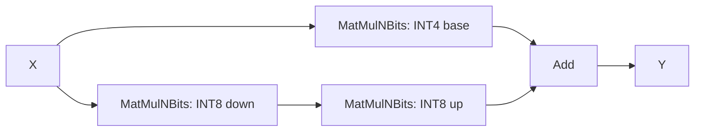

# WebGPU MatMulNBitsQLoRA

`com.microsoft.MatMulNBitsQLoRA` combines a quantized base projection with a
quantized LoRA adapter during inference. Adapter weights remain separate and
replaceable; the operator does not merge them into the base weights or train them.
It reduces dispatches and intermediate memory traffic by sharing input preparation
and computing the adapter contribution inside existing MatMulNBits shaders.

## Operator contract and current support

The [operator definition](ContribOperators.md#com.microsoft.matmulnbitsqlora)
follows MatMulNBits quantization and packing rules. It allows arbitrary positive
adapter ranks, including ranks not divisible by eight or the block size. Partial
blocks are padded, and only logical elements participate in the projections.

The current WebGPU kernel and graph matcher implement this subset:

- FP16 or FP32 activations, scales, intermediate projections, and output, all
  using the same floating type.
- INT4 base weights and INT8 adapter weights, all with block size 32.
- Active adapter rank 32, or empty packed adapter weights as described below.
- Input `X` of rank at least two, positive `K` divisible by 32, and positive `N`.
  `N` need not be divisible by four; scalar output tails are supported.
- Implicit zero points: 8 for the base and 128 for the adapters. No bias,
  explicit zero points, or group indices.

These are implementation limits, not additional schema restrictions. Explicit
nodes reject unsupported configurations; the transformer leaves unsupported
patterns unfused. The fused kernel is available only on WebGPU. Both built-in and
plugin WebGPU can use it; plugin deployments need an ORT host with the schema and
transformer as well as a provider library with the kernel.

For the current implementation, the active inputs are:

| Input | Storage type | Shape |
| --- | --- | --- |
| `X` | FP16 or FP32 | `[..., M, K]` |
| `W` | Packed INT4 in UINT8 | `[N, K/32, 16]` |
| `scales` | Same as `X` | `[N, K/32]` or flattened |
| `lora_A` | Packed INT8 in UINT8 | `[32, K/32, 32]` |
| `lora_A_scales` | Same as `X` | `[32, K/32]` |
| `lora_B` | Packed INT8 in UINT8 | `[N, 1, 32]` |
| `lora_B_scales` | Same as `X` | `[N, 1]` |

Let `A_down` and `B_up` be the logical dequantized matrices of shapes `[K, 32]`
and `[32, N]`. The adapter bytes represent signed values offset by 128, multiplied
by their block scales. The computation is:

```text
base  = MatMulNBits(X, W, scales)
T     = X * A_down
delta = T * B_up
Y     = base + delta
```

"Down" projects the input features to the adapter rank; "up" projects that rank
to the output features. `delta` is the adapter's contribution to the output.
`T` has shape `[..., M, 32]`, and `Y` has shape `[..., M, N]`. Dequantized weights
and intermediate projection results use the activation type before addition.
Any LoRA scaling factor must already be represented in the weights/scales; the
operator has no separate adapter multiplier.

## Automatic graph fusion

[MatMulNBitsQLoRAFusion](../onnxruntime/core/optimizer/matmul_nbits_qlora_fusion.cc)
runs at `ORT_ENABLE_EXTENDED` or higher when WebGPU provides the fused kernel.
It matches this graph, accepting either order of the final Add inputs:



All four nodes must be assigned to WebGPU. The down projection must consume the
same `X` as the base projection. The base, down, and up outputs must each have
one consumer and must not be graph outputs. Packed shapes must match the layout
above, with logical dimensions established by the MatMulNBits `K`/`N` attributes.
Both adapter nodes must use `accuracy_level=0`; the fused node inherits the base
node's accuracy setting. Bias, explicit zero points, group indices, or prepacked
weights (`weight_prepacked != 0`) prevent matching.

Fusion reuses the input NodeArgs and preserves initializer shapes, contents, and
overridability. It does not quantize adapters, compact zero defaults, or match
arbitrary DequantizeLinear/Cast/MatMul graphs. Such graphs need an offline
conversion to the packed MatMulNBits representation first.

No QLoRA-specific enable option is needed. To compare with the raw graph, set
the session configuration entry `optimization.disable_specified_optimizers` to
`MatMulNBitsQLoRAFusion` (append it with a semicolon if other names are present).
Disabling the transformer does not expand explicitly exported fused nodes.

## Execution and optimization

[MatMulNBitsQLoRA::ComputeInternal](../onnxruntime/contrib_ops/webgpu/quantization/matmul_nbits_qlora.cc)
selects a path from the input shape, accuracy policy, and device capabilities.
Here, `M` is the second-to-last dimension of `X`; a one-token prompt uses the
same selection as decode. Graph fusion does not imply a single GPU dispatch.

| Case | Execution |
| --- | --- |
| Either packed adapter is empty | Run ordinary base MatMulNBits, before allocating or dispatching adapter work. |
| Prefill (`M > 1`) | Compute `T`, then fuse the up projection and addition into the base shader's output stage. |
| Eligible decode (`M = 1`) | Compute base and down projections in separate workgroups of one dispatch, then run an up-plus-add output shader. |
| Other decode shapes | Compute down and base projections separately, then run the up-plus-add output shader. |

Packed weights are dequantized where consumed, avoiding full floating-point
adapter-weight tensors. Prefill retains the rank-sized `T` intermediate while
avoiding separate base and adapter-delta output tensors. Decode retains separate
base and `T` outputs; the following dispatch synchronizes them before addition.

### DP4A

The [shared DP4A implementation](../onnxruntime/contrib_ops/webgpu/quantization/dp4a_matmul_nbits.cc)
can quantize `X` once and reuse its packed values and scales for the base and
down projections within an invocation. Its normal eligibility checks, including
`accuracy_level=4`, still apply. Eligible prefill therefore uses quantization,
down projection, and base-plus-up dispatches. FP32 short prefill can also share
this preparation when the base selects DP4A.

The rank-32 down projection uses the existing K-parallel kernel selection:
`M < 4`, or narrow output (`N <= 32`) with `K >= 2048`. Narrow reductions use
FP32 accumulation. Other shapes use the existing tiled DP4A kernel; the LoRA
output stage extends its computation without changing its matrix tiling.

For FP32 decode with `2048 <= K <= 8192` and a DP4A base, the joint kernel adds
down-projection workgroups to the base dispatch. Both projections read the same
quantized `X`; up-plus-add is a separate dispatch. Prepared inputs are scoped to
the invocation and are not reused as cached values across different inputs.

### Subgroup matrix

The [subgroup-matrix implementation](../onnxruntime/contrib_ops/webgpu/quantization/subgroup_matrix_matmul_nbits.cc)
adds the up projection using matrix instructions in the base shader's output
stage. On a compatible FP16 `8x16x16` configuration, a specialized path packs `X`
once for both projections, with row padding sufficient for both tile sizes.
The narrow down projection uses FP32 matrix accumulation and stores `T` in the
activation type; the base projection then consumes `T` for the fused up stage.

Selection requires supported component types, matrix dimensions, subgroup size,
and device limits. Choosing a Vulkan backend alone does not guarantee support.
If the shared-packing specialization is unavailable, normal MatMulNBits selection
computes the down projection and selects an eligible base-plus-up shader.

### Floating-point decode and shader helpers

For one total input row, `2048 <= K <= 8192`, and a base that does not select
DP4A, the generic base shader appends four down-projection workgroups. A compatible
32-lane subgroup path reuses input values in registers and reduces partial sums;
other devices use workgroup memory. A variable subgroup range requires explicit
subgroup-size control before requesting 32 lanes.

[GenerateQLoRADown and GenerateQLoRAUp](../onnxruntime/contrib_ops/webgpu/quantization/matmul_nbits_qlora.h)
append reusable WGSL fragments to a caller's shader; they do not dispatch GPU work.
The [down template](../onnxruntime/contrib_ops/webgpu/quantization/matmul_nbits_qlora_down.wgsl.template)
supplies the generic joint-decode body. The
[up template](../onnxruntime/contrib_ops/webgpu/quantization/matmul_nbits_qlora_up.wgsl.template)
supplies dequantization and adapter-delta helpers used by fused prefill and the
separate decode output shader. Subgroup-matrix shaders reuse the dequantization
helper and implement the multiplication with their own matrix instructions.

## Optional adapters and portable models

Use the raw three-MatMulNBits-plus-Add pattern for a model shared by CPU and
WebGPU. CPU executes the original operators; WebGPU fuses eligible patterns.
Saving the optimized graph serializes explicit MatMulNBitsQLoRA nodes, which
require its WebGPU kernel.

To export a compact adapter-off default, use overridable initializers with these
shapes and also list them as graph inputs:

| Initializer | Default shape | Contents |
| --- | --- | --- |
| `lora_A` | `[0, K/32, 32]` | Empty packed weights |
| `lora_B` | `[N, 0, 32]` | Empty packed weights |
| `lora_A_scales` | `[32, K/32]` | Retained scale defaults |
| `lora_B_scales` | `[N, 1]` | Retained scale defaults |

Declare the packed graph inputs' adapter axes as dynamic: axis 0 for `lora_A`
and axis 1 for `lora_B`. This allows active rank-32 weights to override the empty
defaults. Either empty packed weight disables the adapter. Scale-only or
single-weight overrides therefore retain the base result; both packed weights
activate the adapter using supplied scales or their defaults. Scale defaults may
also be empty, but activation then requires supplying their active shapes and data.

This convention relies on empty-weight MatMulNBits support in the raw graph.
Full-size zero adapter weights still execute arithmetic, including its NaN/Inf
behavior. The transformer deliberately preserves them instead of converting them
to empty tensors.

## Numerical behavior, capture, and limitations

`accuracy_level` follows MatMulNBits policy for the base and eligible down
projections. Level 4 permits DP4A activation quantization, including in an
optimized down projection whose raw node uses level 0. Quantization, reduction
order, and accumulation precision can change results relative to the raw graph;
fusion does not promise bitwise equivalence. `enableMatmulFp32Accumulation`
controls accumulation in the shaders that honor that option; it does not disable
activation quantization. Evaluate fused-versus-raw differences separately from
the change caused by quantizing an originally floating-point adapter.

Graph replay does not re-evaluate the empty-adapter branch. Native callers must
use distinct `gpu_graph_id` values for adapter-off and adapter-on captures, and
for other changes to shapes or execution paths. Each capture needs compatible,
stable GPU bindings and buffer lifetimes. Updating adapter values in the same
buffers can reuse a capture when shapes, layout, and dispatches remain compatible;
replacing a buffer or changing the path requires recapture. WebGPU does not derive
the capture ID from adapter state.

The current QKV/MLP fusions do not compose with MatMulNBitsQLoRA. An empty adapter
uses standalone base MatMulNBits, so it may have different performance from a
separate base-only graph that benefits from those fusions. Supporting arbitrary
active ranks, additional quantization settings, and composed base fusions requires
further kernel/transformer work; the broader operator schema already allows rank
and quantization extensions.

## Validation

From a native WebGPU build's test output directory, run:

```text
onnxruntime_provider_test.exe --gtest_filter="*QLoRA*:*MatMulNBitsInputPreparation*"
onnxruntime_test_all.exe --gtest_filter="*MatMulNBitsQLoRA*"
```

[Provider tests](../onnxruntime/test/contrib_ops/matmul_nbits_qlora_test.cc) and
[fusion tests](../onnxruntime/test/optimizer/matmul_nbits_qlora_fusion_test.cc)
cover FP16/FP32 numerics, prefill/decode, batching and tails, empty and partial
adapters, serialization, capture replay, and patterns that must remain unfused.
Hardware-specific tests skip when the required features are absent; those skips
do not validate the corresponding shader path. Full-model evaluation should also
check logits and generated tokens with each intended adapter and capture mode.
