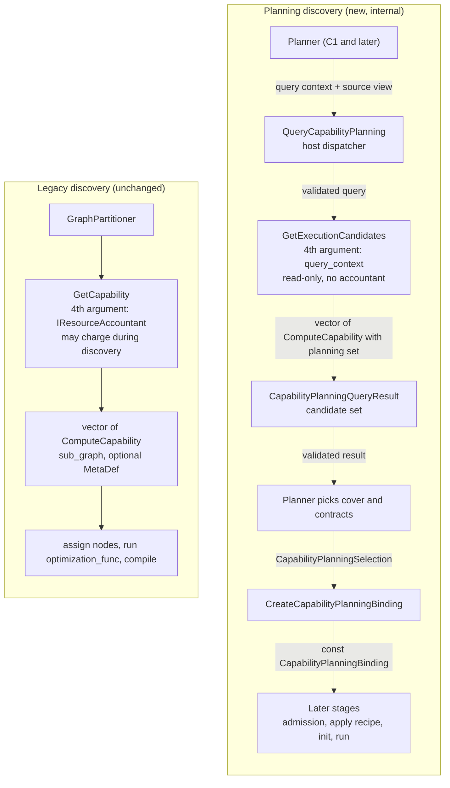
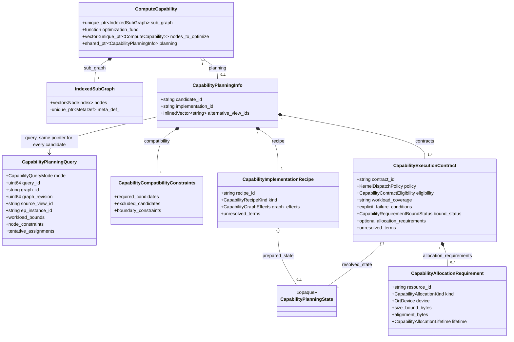
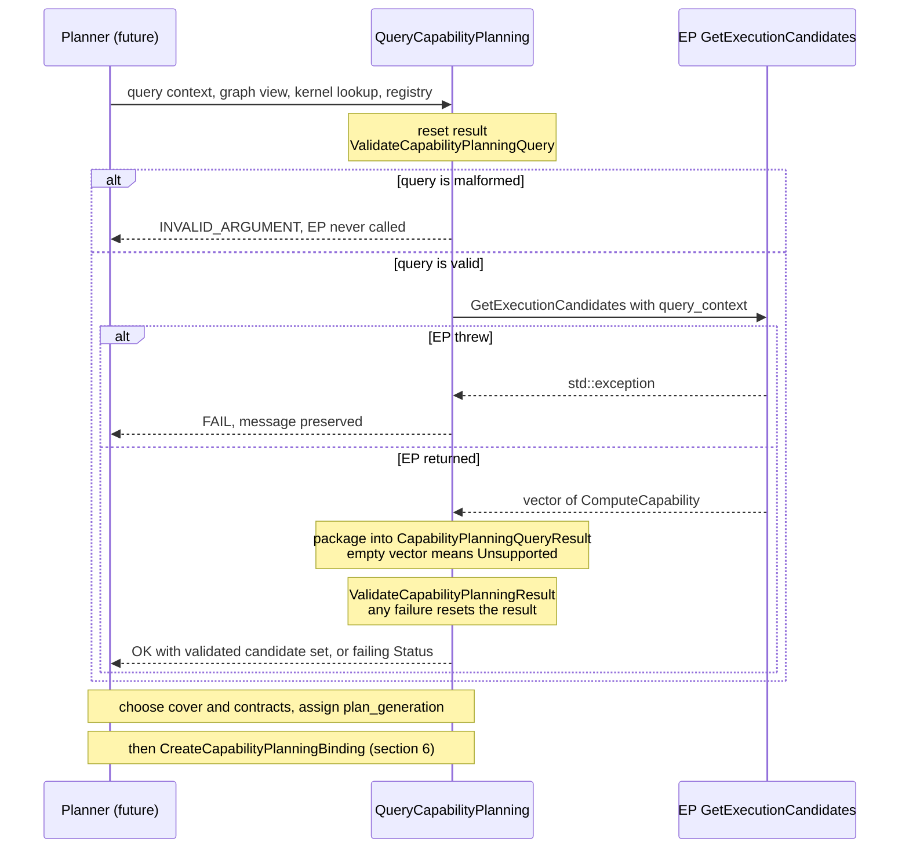
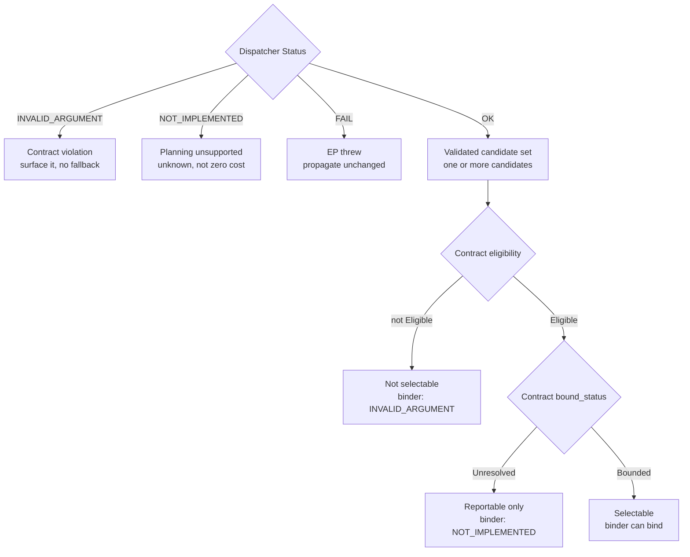
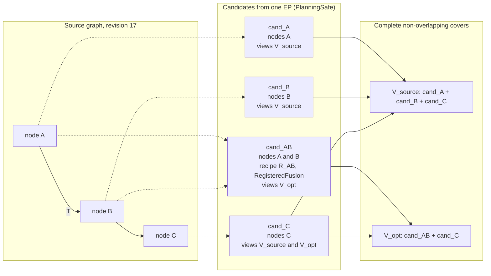
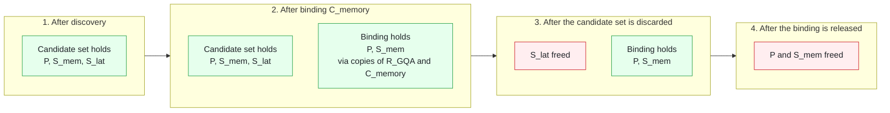
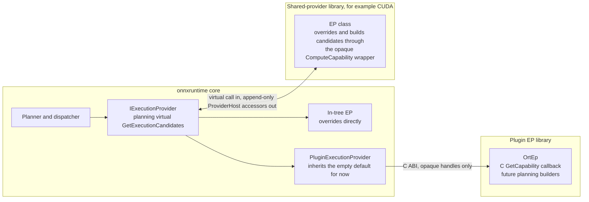

# Capability Planning Interfaces: Execution Candidates and `ComputeCapability`

This draft defines the signatures and contracts that [S0](capability_planning_s0.md) leaves open: how an execution
provider (EP) answers a *planning* query, and how each execution candidate is carried in a `ComputeCapability`. It
supports the discovery step of the
[region-aware placement proposal](https://github.com/microsoft/onnxruntime/pull/33372)
([pinned design section](https://github.com/microsoft/onnxruntime/blob/c3f809596077921ad5f8500564f3476c4bc0927c/docs/annotated_partitioning/PartitioningWithAnnotationsAndMemoryConstraints.md#proposed-automatic-region-aware-cpugpu-placement)).

It does not define the planner, covers, budget admission, recipe application, or any kernel policy
(see [Out of scope](#14-out-of-scope)). Start with sections 1, 3 and 5. Sections 11 and 13 list the decisions that
need reviewer input.

> **Design decision.** Planning reuses the existing shapes. A new virtual,
> `IExecutionProvider::GetExecutionCandidates`, returns the same `std::vector<std::unique_ptr<ComputeCapability>>` as
> `GetCapability`, takes the query context as its fourth argument, and carries all planning data in the optional
> `ComputeCapability::planning` member that S0 added. `GetCapability`, `ComputeCapability`, `nodes_to_optimize`, and
> `optimization_func` keep their current signatures and meaning. The new virtual has its own name and is declared
> after every existing virtual, so it adds one vtable slot and moves none, on both the Itanium and MSVC ABIs
> ([section 9.1](#91-abi-compatibility)).
>
> The call shape is the one sketched in the proposal,
> `GetCapability(graph_view, kernel_lookup, optimizer_registry, query_context) -> execution_candidates[]`, under a
> different name. Alternatives in [section 11](#11-alternatives-considered): A keeps the proposal's name as a same-name
> overload, B is one signature keyed on `mode`, and D returns `Status` and fills a result out-parameter. The name
> `GetExecutionCandidates` is illustrative ([open question 6](#13-open-questions)).

| Item | Status |
|:-----|:-------|
| Planning types, `ComputeCapability::planning`, `ValidateCapabilityPlanningResult`, `CreateCapabilityPlanningBinding`, `ValidateCapabilityPlanningBindingIdentity` | In S0 (#33841) |
| Planning virtual `IExecutionProvider::GetExecutionCandidates`, its base default, and a forward declaration of `CapabilityPlanningQuery` | **Proposed here**, lands with C1 |
| Host dispatcher `QueryCapabilityPlanning` and exported `ValidateCapabilityPlanningQuery` | **Proposed here**, lands with C1 |
| Shared-provider bridge entries | **Proposed here**, append-only, lands with C1 |
| Plugin-EP C ABI | Mapping requirements only (S0.4). No names or layouts are proposed |
| Code in this document | Illustrative. It was not compiled against ORT's headers. [Section 12](#12-verification-evidence) lists what was and was not checked |

## 1. Summary

```cpp
// include/onnxruntime/core/framework/execution_provider.h

// Forward declaration, next to IResourceAccountant and outside #ifndef SHARED_PROVIDER.
struct CapabilityPlanningQuery;

// Unchanged. Existing EPs and the partitioner keep using it.
virtual std::vector<std::unique_ptr<ComputeCapability>>
GetCapability(const onnxruntime::GraphViewer& graph_viewer,
              const IKernelLookup& kernel_lookup,
              const GraphOptimizerRegistry& graph_optimizer_registry,
              IResourceAccountant* resource_accountant = nullptr) const;

// New. Declared after the last existing virtual of the class, under a name no other member has (section 9.1).
// Same return type. The fourth argument is the planning query context instead of an accountant.
// Overriding it is an EP's opt-in to planning-safe discovery.
virtual std::vector<std::unique_ptr<ComputeCapability>>
GetExecutionCandidates(const onnxruntime::GraphViewer& graph_viewer,
                       const IKernelLookup& kernel_lookup,
                       const GraphOptimizerRegistry& graph_optimizer_registry,
                       const std::shared_ptr<const CapabilityPlanningQuery>& query_context) const;
```

`ComputeCapability` keeps its shape. Planning adds nothing beyond the optional member that S0 already added (members
only; constructors and comments omitted):

```cpp
struct ComputeCapability {
  std::unique_ptr<IndexedSubGraph> sub_graph;  // existing: which source nodes
  std::function<Status(Graph&, const ComputeCapability& /*this_optimization*/, ComputeCapability& /*cc_to_update*/,
                       const GraphOptimizerRegistry&)>
      optimization_func;                                              // existing, optional
  std::vector<std::unique_ptr<ComputeCapability>> nodes_to_optimize;  // existing, optional
  std::shared_ptr<const CapabilityPlanningInfo> planning;             // S0, optional: views, recipe, contracts
};
```

Design points:

1. **Same shapes.** Same return type, same `ComputeCapability`, same first three parameters. The planning virtual
   differs from `GetCapability` in its name and its fourth parameter. Nothing in the existing partitioner calls it, so
   default behavior is unchanged.
2. **Participation is a candidate.** An EP takes part in a planning query by returning `ComputeCapability` objects
   whose `planning` is set. There is no `Status`, `support` flag, or out-parameter at the EP boundary. The host-side
   dispatcher (5.4) packages the vector into S0's `CapabilityPlanningQueryResult`.
3. **The query context takes the accountant's place.** Passing a null accountant makes the CUDA EP skip its resource
   queries, and passing a real one would charge during discovery. Planning returns requirements as data in each
   candidate's contracts.
4. **Opt-in by override. An empty vector means unsupported.** The base default returns an empty vector, and the
   dispatcher reports an empty vector as `Unsupported` (unknown, not zero). There is no separate `SupportsPlanning()`
   virtual that could disagree with the override. The cost of this choice is [open question 2](#13-open-questions).
5. **One shared query snapshot.** Every candidate holds the same `shared_ptr` to the query. The S0 validator compares
   pointers, so a stale or foreign candidate is rejected.
6. **No side effects. Existing hooks coexist.** Discovery does not mutate the graph, run `optimization_func`, compile,
   create kernels, allocate device weights, or charge an `IResourceAccountant`. A candidate may still carry
   `nodes_to_optimize` and `optimization_func` for the later application step. Planning never invokes them.
7. **Append-safe vtable.** The virtual is declared last and has a name no other virtual has. A same-name overload
   would join the legacy `GetCapability` group on MSVC and move the legacy slot and every later one. See
   [section 9.1](#91-abi-compatibility).

| EP behavior | Result at the host |
|:------------|:-------------------|
| Returns candidates that all carry valid `planning` | OK, `PlanningSafe` |
| Returns an empty vector (also what the base default returns) | `NOT_IMPLEMENTED`: unknown, not zero |
| Returns a candidate with no `planning`, for example forwarded legacy output | `NOT_IMPLEMENTED` |
| Returns an invalid candidate: null entry, foreign query, duplicate or empty ids, malformed bounded claims | `INVALID_ARGUMENT`. The whole result is rejected |
| Throws | `FAIL`, message preserved |

## 2. Terms

| Term | Meaning |
|:-----|:--------|
| Query context | `CapabilityPlanningQuery`, passed as `query_context`: an immutable snapshot of graph identity, workload bounds, node constraints, tentative placement, and EP configuration. |
| Execution candidate | One `ComputeCapability` with `planning` set: one way this EP could cover a set of source nodes. Identified by `planning->candidate_id`. S0 text and error messages call it an "offer". |
| Candidate set | An EP's candidates for one query, packaged by the dispatcher into S0's `CapabilityPlanningQueryResult` together with `support` and `diagnostic`. Nothing is selected yet. EP code never sees this type. |
| View | A named version of the graph that a candidate applies to, for example `V_source` (as imported) or `V_opt` (with an EP fusion applied). Listed in `alternative_view_ids`. |
| Recipe | How a candidate is realized: `Standalone`, `RegisteredFusion`, or `CompiledRegion`, plus its declared graph effects. |
| Contract | A policy-specific (`KernelDispatchPolicy`) promise: eligibility, workload coverage, allocation requirements, and EP-private resolved state. A candidate may carry several. |
| Selection | `CapabilityPlanningSelection`: the planner's choice of candidate, recipe, view, contract, and plan generation. |
| Binding | `CapabilityPlanningBinding`: the const, validated result of a selection. It keeps only the chosen recipe and contract. |

## 3. End-to-End Flow

Planning discovery is a second path next to the legacy one, not a replacement. Both paths return the same
`ComputeCapability` shape.



| | Legacy | Planning |
|:--|:-------|:---------|
| Caller | `GraphPartitioner` | `QueryCapabilityPlanning`, called by the future planner |
| Virtual | `GetCapability` | `GetExecutionCandidates` |
| Fourth argument | `IResourceAccountant*`, default `nullptr` | `std::shared_ptr<const CapabilityPlanningQuery>` |
| Graph shown | The partitioner's current view | The source view named by `query_context->source_view_id`, before any selected-placement filter. Placement context arrives in `tentative_assignments` and `node_constraints` |
| Resource accounting | Optional `IResourceAccountant*`, charged during discovery | None. Requirements are returned in each contract |
| Result | `ComputeCapability` with `sub_graph` and optional `MetaDef`. The partitioner later consumes `nodes_to_optimize` and `optimization_func` | `ComputeCapability` with `planning` set. Planning never invokes `nodes_to_optimize` or `optimization_func` |

## 4. `ComputeCapability`

### 4.1 Shape

The proposal's information model, with the existing hooks kept in place:

```text
ComputeCapability
|-- sub_graph
|   `-- source-node membership and supplied or derived boundary inputs/outputs
|-- nodes_to_optimize (optional, existing)
|   `-- child ComputeCapability requests identifying subsets to optimize
|-- optimization_func (optional, existing)
|   `-- callback on an optimization request; mutates the Graph and updates the parent capability
`-- planning (optional, S0)
    |-- candidate_id + graph_revision
    |-- alternative_view_ids + compatibility_constraints
    |-- implementation_recipe
    |   |-- standalone kernel, fused kernel, or compiled-region lowering
    |   |-- application_handle / recipe_state
    |   `-- planning_graph or graph_effects_description
    `-- contracts[]
        |-- contract_id + EP-owned resolved contract state
        |-- eligibility / workload coverage / explicit-failure conditions
        |-- allocation_requirements[]
        `-- bound_status / unresolved_terms
```

S0 names the planning members as follows:

| Proposal name | S0 member | Notes |
|:--------------|:----------|:------|
| `sub_graph` membership | `sub_graph->nodes` | The part of `sub_graph` that S0 validates: non-empty and duplicate-free |
| Boundary inputs and outputs | `sub_graph->GetMetaDef()`, or `recipe.graph_effects.boundary_inputs` and `boundary_outputs` | Supplied by the EP or derived from the graph. The proposal does not imply that every boundary field already exists on `IndexedSubGraph`. S0 does not validate `MetaDef` |
| `candidate_id` | `planning->candidate_id` | Unique within one result. S0 also requires `implementation_id` |
| `graph_revision` | `planning->query->graph_revision` | Not copied onto the candidate. The shared query pointer is the validity token |
| `alternative_view_ids` | `planning->alternative_view_ids` | At least one entry, unique |
| `compatibility_constraints` | `planning->compatibility` | `required_candidates`, `excluded_candidates`, `boundary_constraints` |
| `implementation_recipe` | `planning->recipe` | `recipe_id`, `kind` (`Standalone`, `RegisteredFusion`, `CompiledRegion`, or `Unresolved`), `unresolved_terms` |
| `application_handle / recipe_state` | `recipe.prepared_state` | Opaque `CapabilityPlanningState` |
| `planning_graph or graph_effects_description` | `recipe.graph_effects` | `Unresolved`, `Unchanged`, or `Described`. S0 has no planning-graph type, only the compact description |
| `contracts[]` | `planning->contracts` | At least one. Members below |
| `contract_id` and resolved state | `contract_id`, `resolved_state` | EP-owned, opaque |
| Eligibility, coverage, failure conditions | `eligibility` with `eligibility_reason`, `workload_coverage`, `explicit_failure_conditions` | |
| `allocation_requirements[]` | `allocation_requirements` | `std::optional`. Unset means unknown, not none |
| `bound_status` and `unresolved_terms` | `bound_status`, `unresolved_terms` | |

The query context maps the same way: `user_constraints` is `node_constraints`, `device/configuration` is
`execution_device`, `ep_configuration`, and the concurrency bounds, and `mode` is `CapabilityQueryMode`. S0 validates
that `mode` is `Planning`, but the virtual's name already implies it. `mode` would carry the choice under
Alternative B.

### 4.2 Types



`nodes_to_optimize` holds child `ComputeCapability` objects of the same type. `planning` is
`std::shared_ptr<const CapabilityPlanningInfo>` in code. `allocation_requirements` is an `std::optional`: unset means
the list is unknown, not that there are no allocations. `IndexedSubGraph` keeps its `MetaDef` in a private member,
read with `GetMetaDef()` and set with `SetMetaDef()`. The boxes show the main fields only. `capability_planning.h`
has the full definitions.

How each member is read in planning mode:

| Member | Legacy meaning | Planning meaning |
|:-------|:---------------|:-----------------|
| `sub_graph->nodes` | Nodes the EP claims | Source nodes this candidate covers. Must be non-empty and duplicate-free |
| `sub_graph->GetMetaDef()` | Fused-node definition the partitioner turns into a node | Optional boundary description. S0 neither validates nor applies it. See [open question 5](#13-open-questions) |
| `nodes_to_optimize` | Child capabilities naming node subsets to optimize | Optional, existing. Carried, never read by the dispatcher, planner, or binder |
| `optimization_func` | Callback the partitioner runs after assignment: it mutates the `Graph` and updates the parent capability | Optional, existing. Carried, never invoked during discovery, planning, or binding |
| `planning` | Absent | Declarative metadata. Absence does not establish zero planning requirements |

**Enforced by `ValidateCapabilityPlanningResult` (S0).** Per candidate: non-null; `sub_graph` present with valid
`nodes`; `planning` present and `planning->query` is the same pointer as the query; non-empty `candidate_id` (unique
within the result), `implementation_id`, and `recipe_id`; at least one unique `alternative_view_ids` entry and at least
one contract; an `Unresolved` recipe or graph effects must list `unresolved_terms`; `Unchanged` effects cannot declare
introduced, removed, or aliased values; contract ids are unique; a contract that is not `Eligible` needs
`eligibility_reason`; a `Bounded` contract needs a complete requirement list (unique ids, known kind, lifetime, device,
size, and alignment); an `Unresolved` contract needs `unresolved_terms`. A result with candidates must also be marked
`PlanningSafe`, which the dispatcher does.

### 4.3 The existing hooks coexist with `planning`

The proposal treats `nodes_to_optimize` and `optimization_func` as *application* hooks, not pre-assignment requirement
descriptions. A candidate can carry the hooks and `planning` together. Each stage reads a different part:

| Stage | Reads | Does not touch |
|:------|:------|:---------------|
| Discovery (the EP) | Builds `sub_graph`, `planning`, and optionally the hooks | |
| Dispatcher and result validator | `sub_graph->nodes`, `planning` | The hooks |
| Planner (covers and contracts) | `sub_graph->nodes`, `planning` | The hooks |
| Binder | `planning`: the selected recipe and contract | The hooks |
| Recipe application (F2, later) | The selected candidate's hooks, then reconciles against `planning->recipe` | |
| Legacy partitioner | `sub_graph`, `nodes_to_optimize`, `optimization_func` | `planning` |

Rules for an EP that sets both:

1. **Planning does not run the hooks.** S0: binding does not run `optimization_func`; F2 later applies and reconciles
   the selected recipe.
2. **Same implementation.** A hook must apply the recipe the candidate describes. It must not independently select a
   different fusion or implementation. S0 does not check this. See [open question 5](#13-open-questions).
3. **No borrowed graph state in closures.** Anything stored on the candidate outlives the discovery call. Do not
   capture that call's `GraphViewer`, `Node*`, or `NodeArg*` in `optimization_func`.
4. **Selection functions are allowed.** The planning virtual keeps `graph_optimizer_registry`. An EP may look up a
   registered optimizer and run its selection function, which takes a `const GraphViewer&`, to build
   `nodes_to_optimize`, following steps 1 to 4 in the `GetCapability` header comment. It must not run the
   `optimization_func` that the selection returns.
5. **Existing producers.** TensorRT EP and the CUDA runtime-fusion work (#33705, #33757) already populate these hooks
   on the legacy path. Planning integration for them is future work (see [Out of scope](#14-out-of-scope)).

## 5. `GetExecutionCandidates`

### 5.1 Parameters

| Parameter | Role |
|:----------|:-----|
| `graph_viewer` | Read-only view of the source graph, before any selected-placement filter. Call-scoped: do not keep it or any `Node` or `NodeArg` pointer after returning |
| `kernel_lookup` | Same as legacy: is a kernel registered for this node on this EP |
| `graph_optimizer_registry` | Same object as legacy. An EP may look up optimizers and run their read-only selection functions (4.3). It must not run an `optimization_func` or otherwise change the graph |
| `query_context` | Immutable snapshot of workload, constraints, and placement context. It is a `shared_ptr` so every candidate can hold the same snapshot. Never null: the dispatcher validates it first |
| Return value | The EP's execution candidates, each a `ComputeCapability` with `planning` set. An empty vector means no planning-safe answer (5.3) |

There is no `IResourceAccountant*`. Passing a null accountant to `GetCapability` would not discover requirements
(the CUDA EP then returns bare single-node capabilities without its resource queries), and passing a real one would
charge resources during discovery. Planning reports requirements as data instead.

New inputs belong in `CapabilityPlanningQuery` and new outputs in `CapabilityPlanningInfo`. Neither changes the
virtual's signature.

### 5.2 Contract

| Party | Rule |
|:------|:-----|
| EP | **Read-only.** Do not mutate the `Graph`, run `optimization_func`, compile, create kernels, allocate bulk device memory such as weights, or charge an accountant |
| EP | **Call-scoped graph access.** Do not retain `GraphViewer`, `Node`, or `NodeArg` pointers. State that must outlive the call goes in an EP-owned `CapabilityPlanningState` |
| EP | **Repeatable.** The same graph and query give the same candidates. The host may re-query when placement changes |
| EP | **Same query.** Set every candidate's `planning->query` to the `query_context` argument itself, not a copy |
| EP | **Return planning candidates.** Every returned `ComputeCapability` has `planning` set. Forwarded legacy output is rejected as `NOT_IMPLEMENTED`, because a missing payload is not zero cost |
| EP | **Return only candidates this EP owns.** Combining candidates across EPs is the planner's job |
| EP | **Describe, do not guess.** Put unknown terms in `unresolved_terms` instead of inventing numbers or throwing |
| EP | **Throw only for real failures.** The dispatcher converts an exception to `FAIL` (5.4). With exceptions disabled a throw aborts |
| Host | Pass a validated query. The dispatcher guarantees it (5.4) |
| Host | Pass the viewer of `query_context->source_view_id`. Convey placement through `tentative_assignments` and `node_constraints`, not by filtering the viewer |
| Host | Call one EP instance serially, as the partitioner does today |
| Host | Treat the candidate set as unusable unless the dispatcher returned OK |

### 5.3 Default Behavior and Placement

```cpp
// execution_provider.cc. provider_bridge_provider.cc defines the same default for shared-provider libraries.
std::vector<std::unique_ptr<ComputeCapability>>
IExecutionProvider::GetExecutionCandidates(const GraphViewer&, const IKernelLookup&, const GraphOptimizerRegistry&,
                                           const std::shared_ptr<const CapabilityPlanningQuery>&) const {
  return {};
}
```

- **Out of line.** `ComputeCapability` is incomplete in `execution_provider.h`, so the default is defined in a `.cc`
  file. A shared-provider library defines its own copy in `provider_bridge_provider.cc`. It returns without calling
  core, so it needs no `ProviderHost` entry.
- **No side effects, and it does not wrap legacy output.** The legacy base default claims every node that has a kernel
  (`execution_provider.cc`) and carries no requirement data. An EP's legacy override may also compile or charge an
  accountant. Neither is planning-safe. A "proven legacy adapter" can be an opt-in helper that an EP calls from its own
  `GetExecutionCandidates` override. It is not an implicit default.
- **Empty means unsupported.** A vector return cannot tell "this EP has no planning-safe discovery" from "this EP
  looked and found nothing eligible". The dispatcher resolves the tie toward `Unsupported`, so a missing override is
  never read as a proven-empty answer. S0's `PlanningSafe`-with-no-candidates state stays valid, but this call path
  cannot produce it. See [open question 2](#13-open-questions).
- **The CPU EP** does not override `GetCapability`; it uses the base kernel-lookup default. It therefore reports
  planning as unsupported until it gets a `GetExecutionCandidates` override or an explicit adapter
  ([open question 8](#13-open-questions)).
- **Placement.** Declare the new virtual after `GetEpContextDataCallbackRequirements`, the last virtual of
  `IExecutionProvider` today, and give it a name no other member of the class has. Together these add one vtable slot
  and move none, on both the Itanium and MSVC ABIs ([section 9.1](#91-abi-compatibility)).
- **No overload mechanics.** `GetCapability` and `GetExecutionCandidates` never compete in overload resolution. An EP
  that overrides one hides nothing, and no existing call site changes meaning.

### 5.4 Dispatcher

The host never calls the virtual directly. It calls a dispatcher that validates on both sides of the EP call and turns
the returned vector into S0's result type.

```cpp
// New header that includes execution_provider.h. Name and location are illustrative:
// IKernelLookup is nested in IExecutionProvider, so capability_planning.h cannot host it.
Status QueryCapabilityPlanning(const IExecutionProvider& ep,
                               const GraphViewer& graph_viewer,
                               const IExecutionProvider::IKernelLookup& kernel_lookup,
                               const GraphOptimizerRegistry& graph_optimizer_registry,
                               const std::shared_ptr<const CapabilityPlanningQuery>& query_context,
                               CapabilityPlanningQueryResult& result) {
  result = CapabilityPlanningQueryResult{};
  auto status = ValidateCapabilityPlanningQuery(query_context);  // EP code never sees a malformed query
  if (!status.IsOK()) {
    return status;
  }

  std::vector<std::unique_ptr<ComputeCapability>> candidates;
  ORT_TRY {
    candidates = ep.GetExecutionCandidates(graph_viewer, kernel_lookup, graph_optimizer_registry, query_context);
  }
  ORT_CATCH(const std::exception& ex) {
    ORT_HANDLE_EXCEPTION([&]() {
      status = ORT_MAKE_STATUS(ONNXRUNTIME, FAIL, "EP threw during planning discovery: ", ex.what());
    });
  }
  if (!status.IsOK()) {
    return status;
  }

  for (auto& candidate : candidates) {
    result.capabilities.push_back(std::move(candidate));  // null entries are kept so the validator reports them
  }
  if (result.capabilities.empty()) {
    result.support = CapabilityPlanningSupport::Unsupported;
    result.diagnostic = "The EP returned no planning execution candidates.";
  } else {
    result.support = CapabilityPlanningSupport::PlanningSafe;
  }

  status = ValidateCapabilityPlanningResult(query_context, result);
  if (!status.IsOK()) {
    result = CapabilityPlanningQueryResult{};
  }
  return status;
}

// capability_planning.h: proposed export of S0's anonymous-namespace ValidateQuery.
Status ValidateCapabilityPlanningQuery(const std::shared_ptr<const CapabilityPlanningQuery>& query);
```



- **Why the query is validated before the EP is called.** S0 validates the query only as part of result validation,
  which runs after the EP returns. A throwaway EP that read `query_context->source_view_id` crashed with an access
  violation when given a null query. Exporting the existing `ValidateQuery` as `ValidateCapabilityPlanningQuery`
  closes this: EP code is guaranteed a non-null, well-formed query.
- **Why invalid entries are kept.** The legacy partitioner silently erases null capabilities and capabilities without a
  `sub_graph`. The dispatcher moves every returned entry into the result so the validator reports it. A dropped entry
  would hide an EP bug and could hand the planner an incomplete cover.
- **Failure is all or nothing.** The dispatcher resets the result on any failure and does not drop individual
  candidates. One invalid candidate fails the whole EP result. The returned code is that of the first failing
  candidate. `result.diagnostic` is cleared with the rest of the result, so the text survives only in the returned
  `Status`.
- **Exceptions are the only failure channel.** The vector return has no `Status`. The dispatcher converts a
  `std::exception` into `FAIL`. In a build without exceptions a throw aborts, so an EP should describe expected
  unknowns through `unresolved_terms` and `bound_status` instead of throwing.
  [Open question 7](#13-open-questions) asks whether this is enough.
- **Plain status checks.** The snippet does not use `ORT_RETURN_IF_ERROR`, which also logs a run error.
  `NOT_IMPLEMENTED` from planning is an expected planner input, and S0 leaves reporting of planning diagnostics to the
  caller.

### 5.5 Outcomes



| Dispatcher result | Cause | Planner meaning |
|:------------------|:------|:----------------|
| OK, `PlanningSafe`, one or more candidates | Validated candidate set | Choose a cover and contracts |
| `NOT_IMPLEMENTED` | An empty return (including the base default), or a candidate with no `planning` | Unknown, not zero cost. Whether this blocks planning is planner policy |
| `INVALID_ARGUMENT` | Malformed query (EP not called), or an invalid candidate: null entry, foreign query pointer, duplicate or empty ids, malformed bounded claims | Bug. Never convert to empty discovery |
| `FAIL` | The EP threw during discovery | Propagated unchanged |

### 5.6 If the Proposal's Name Is Kept (Alternative A)

Alternative A declares the planning virtual as a second overload of `GetCapability`, with the query context in place
of the accountant. The language mechanics below were checked with a standalone probe
([section 12](#12-verification-evidence)). The MSVC vtable cost is in [section 9.1](#91-abi-compatibility). A distinct
name needs none of this.

Which overload a call selects, through an `IExecutionProvider` reference (the partitioner's path):

| Fourth argument | Overload | Why |
|:----------------|:---------|:----|
| None | Legacy | Only the legacy overload has a default for it |
| `nullptr` | Legacy | A null-pointer conversion beats the user-defined conversion to `shared_ptr` |
| `IResourceAccountant*` | Legacy | Exact match. `shared_ptr`'s pointer constructor is `explicit` |
| `shared_ptr<const CapabilityPlanningQuery>`, or a non-const `shared_ptr` | Planning | There is no conversion to `IResourceAccountant*` |

Six test call sites in three files pass a literal `nullptr` as the fourth argument (`qnn_test_utils.cc`,
`pattern_rewriter_components_test.cc`, `ep_plugin_provider_test.cc`). They keep binding to the legacy overload.

**Name hiding.**

- A class that overrides one of the two overloads hides the other in its own scope. Calls through
  `IExecutionProvider&`, which is how the partitioner and the dispatcher call, are unaffected. A direct call on the
  concrete type to the hidden overload fails to compile. `using IExecutionProvider::GetCapability;` un-hides it.
- The reverse case is quieter. A class that overrides only the planning overload hides the legacy one, so on that
  concrete type a literal `nullptr` fourth argument binds to the planning overload with a null query. Override both
  overloads, or add the using-declaration.
- **Warnings.** Overriding one of two same-named virtuals does not warn under Clang `-Wall -Wextra`. Clang warns only
  when a derived function overrides none of the same-named base virtuals. GCC 13 and later enable
  `-Woverloaded-virtual=1` under `-Wall`, which per its documentation does not warn when every derived declaration
  overrides something. MSVC C4266 does flag both partial-override shapes, but it is off by default and ORT does not
  enable it. [Section 12](#12-verification-evidence) lists what was executed.

## 6. Selection and Binding

The planner picks one candidate, one view, and one contract and asks for a binding.

```cpp
Status CreateCapabilityPlanningBinding(const std::shared_ptr<const CapabilityPlanningQuery>& query,
                                       const ComputeCapability& capability,
                                       const CapabilityPlanningSelection& selection,
                                       std::shared_ptr<const CapabilityPlanningBinding>& binding);
```

Checks run in this order. The first failure wins and leaves `binding` unchanged.

| Step | Check | Failure |
|:-----|:------|:--------|
| 1 | Query is valid | `INVALID_ARGUMENT` |
| 2 | The whole candidate is valid, including contracts that were not selected | `NOT_IMPLEMENTED` if `planning` is missing, otherwise `INVALID_ARGUMENT` |
| 3 | `plan_generation` is nonzero, and the selection's candidate, recipe, and view ids match the candidate | `INVALID_ARGUMENT` |
| 4 | Recipe kind, recipe terms, graph effects, and effect terms are all resolved | `NOT_IMPLEMENTED` |
| 5 | A `CompiledRegion` recipe or `Described` graph effects has `prepared_state` | `INVALID_ARGUMENT` |
| 6 | The selected `contract_id` exists | `INVALID_ARGUMENT` |
| 7 | The contract is `Eligible` | `INVALID_ARGUMENT` |
| 8 | The contract is `Bounded` | `NOT_IMPLEMENTED` |
| 9 | The contract has `resolved_state` and `workload_coverage` | `INVALID_ARGUMENT` |
| 10 | For covered nodes with a query constraint: the required EP instance matches, and the contract policy is permitted | `INVALID_ARGUMENT` |
| 11 | Build the binding and assign the output | none |

Step 2 validates the candidate as a unit. A malformed sibling contract therefore blocks binding of a healthy one. An
`Unresolved` contract fails only its own binding at step 8 and does not affect its siblings.

The binder reads `planning` only. It does not read or run `optimization_func` or `nodes_to_optimize`.

A binding is a local check. It does not prove whole-plan feasibility and is not budget admission.
`ValidateCapabilityPlanningBindingIdentity(query, plan_generation, binding)` later guards that a binding still
belongs to the active query and plan generation.

## 7. Views and Covers

One EP can return several ways to cover the same nodes. `alternative_view_ids` says which views a candidate belongs to.
The planner picks a view and a complete, non-overlapping cover of it. For `A -> T -> B -> C`, where the EP can fuse
`A` and `B`:



| Cover | View | Candidates | Valid |
|:------|:-----|:-----------|:------|
| 1 | `V_source` | cand_A, cand_B, cand_C | Yes |
| 2 | `V_opt` | cand_AB, cand_C | Yes, if `A` and `B` are placed together on this EP |
| 3 | `V_opt` | cand_AB, cand_B, cand_C | No: `B` is covered twice |
| 4 | `V_source` | cand_A, cand_C | Only if another EP provides a candidate for `B` |

- These are alternative sets of candidates, not necessarily two `ComputeCapability` objects per view. A candidate like
  `cand_C` appears once and lists both views.
- Cross-candidate rules are declared in `planning->compatibility` (`required_candidates`, `excluded_candidates`,
  `boundary_constraints`). The planner enforces them.
- If a placement boundary falls between `A` and `B`, `cand_AB` is not usable. The planner publishes a new query with
  the new tentative assignments and re-queries.
- An indivisible fused or compiled candidate is accepted whole or rejected. Nodes that are already fused in the input
  stay atomic.
- `cand_AB` eliminates the internal value `T`. If a consumer outside `A` and `B` also read `T`, the recipe must
  preserve it or be rejected.
- If `cand_AB` also carries `optimization_func` and `nodes_to_optimize`, they are applied only after `cand_AB` is
  selected. The hooks of an unselected candidate never run.

## 8. Ownership and Lifetime

The example candidate has recipe `R_GQA`, which points to `prepared_state` `P`, and two contracts: `C_memory`, which
points to `resolved_state` `S_mem`, and `C_latency`, which points to `S_lat`. Each pointer is a
`shared_ptr<const CapabilityPlanningState>`. The planner binds `C_memory`. The diagram shows who keeps each state
alive.



| Object | Held by | Released when |
|:-------|:--------|:--------------|
| `CapabilityPlanningQuery` | The planner, every candidate, every binding | The last holder drops it |
| Candidate and its `CapabilityPlanningInfo` | The candidate set | The candidate set is discarded |
| Unselected contract state (`S_lat`) | The candidate set only | The candidate set is discarded |
| Selected recipe and contract state (`P`, `S_mem`) | The candidate set and the binding | The last of the two is dropped |
| `CapabilityPlanningBinding` | Later stages (C3, I2) | The session or kernel owners release it. S0 does not install owners yet |

A binding copies only the selected recipe and contract and does not keep the candidate set. Discarding the candidate
set therefore frees unused contract state while the selected state stays valid.

`CapabilityPlanningState` subclasses, and the closures held by `optimization_func`, are defined and destroyed in the
EP's library. Sessions must release candidates and bindings before that library unloads.

## 9. Crossing EP Boundaries



| EP kind | Reached by | Candidates are built by | C1 work |
|:--------|:-----------|:------------------------|:--------|
| In-tree | Direct virtual override | `std::make_unique<ComputeCapability>`, then assign `planning`. Hooks, if any, use the existing members | The override |
| Shared-provider library (CUDA, ...) | Virtual call through the library's `IExecutionProvider` vtable | `ComputeCapability` is an opaque wrapper created through `ProviderHost`. Attach `planning` through a new append-only accessor such as `ComputeCapability__SetPlanning`. The existing `ComputeCapability__copy_optimization_func` and `ComputeCapability__add_nodes_to_optimize` already bridge the hooks | Define the planning default in `provider_bridge_provider.cc` (the library's vtable references it). Add the accessor to `provider_interfaces.h`, `provider_wrappedtypes.h`, and `provider_bridge_ort.cc` |
| Plugin EP | `PluginExecutionProvider` | It inherits the empty default, so planning is reported as unsupported | Nothing. A later change maps C builders into `ComputeCapability` and `planning` and attaches the host's query snapshot |

- **Forward declaration.** `execution_provider.h` is compiled by core and by shared-provider libraries. Declare
  `struct CapabilityPlanningQuery;` next to `class IResourceAccountant;`, outside the `#ifndef SHARED_PROVIDER` include
  block at the top of the header, so both builds see the type name. The virtual only needs the name.
- **S0 types in provider libraries.** An EP that builds candidates needs the complete `CapabilityPlanningInfo`. The
  recommended approach is to let provider builds include `capability_planning.h`. It is plain data and includes only
  `core/common` headers, the dispatch-policy header that the CUDA EP already includes, `max_shape_override.h`, and
  `ortdevice.h`. Whether it compiles under `SHARED_PROVIDER` has not been checked. See
  [open question 4](#13-open-questions).
- **Host-only result type.** `CapabilityPlanningQueryResult` is filled by the dispatcher. EP code never sees it, and
  its special members stay out of line in core.
- **Append-only bridge.** New `ProviderHost` entries go after the existing ones, and no existing entry is retyped
  ([section 9.1](#91-abi-compatibility)).

The published C callback stays as it is:

```cpp
ORT_API2_STATUS(GetCapability, _In_ OrtEp* this_ptr, _In_ const OrtGraph* graph,
                _Inout_ OrtEpGraphSupportInfo* graph_support_info);
```

S0.4 lists the mapping requirements for a future versioned extension: an explicit planning-safe feature check,
versioned `OrtEpApi` accessors for a borrowed query view, new builders on `OrtEpGraphSupportInfo`, an opaque state
handle with a release callback (ownership transfers on success only), and no STL types, virtual classes, `shared_ptr`,
or borrowed graph pointers across the ABI. New table members are append-only, per
`.github/instructions/c-api.instructions.md`. This document proposes no C names or layouts.

### 9.1 ABI Compatibility

What this design does to each boundary an EP can sit behind:

| Boundary | What crosses it | Existing rule | Effect of this design |
|:---------|:----------------|:--------------|:----------------------|
| Plugin EP C ABI | `OrtEp` callbacks and `OrtEpApi` builders | Published structs are append-only and tagged `\since`. `OrtEp::GetCapability` is `\since 1.23` and cannot change (`.github/instructions/c-api.instructions.md`) | None now. Planning needs a version-gated optional callback and appended builders (S0.4). That is the same under every alternative in [section 11](#11-alternatives-considered) |
| `ProviderHost` vtable | Calls from a shared-provider library into core | Append-only. `provider_interfaces.h` says "Retained for provider vtable ABI compatibility" and "appended at end to preserve vtable ABI compatibility" | One entry appended, `ComputeCapability__SetPlanning`. The planning default is defined in the library, so it needs no entry. Alternative B would retype `IExecutionProvider__GetCapability` |
| `IExecutionProvider` vtable | Calls from core to a shared-provider library's EP object. `execution_provider.h` is compiled into both | None stated. `SupportsMoeOffload` (#33575) was inserted before the older `GetTuningContext`, and `ProviderLibrary::Load` has no version check, so core and the libraries are built together | One virtual declared last under a new name. No existing slot moves on Itanium or MSVC |
| Planning payload | `CapabilityPlanningInfo` and its `std::string`, `InlinedVector`, `std::optional`, and `shared_ptr` members, when a library builds candidates | None stated. The legacy path already returns `std::vector<std::unique_ptr<ComputeCapability>>` across the same boundary | Extends the same layout assumption over a larger surface ([open question 4](#13-open-questions)) |

- **Why the virtual has its own name.** The Itanium ABI (GCC and Clang on Linux and macOS) lays virtual functions out in
  declaration order, so a virtual declared last is appended. MSVC groups virtuals by name: a group sits where its name
  is first declared, and within a group the newest overload comes first. A second virtual named `GetCapability` would
  therefore take the group's first slot and move the legacy `GetCapability` and the 32 virtuals declared after it,
  wherever the new one is declared. A new name starts its own group at the end. The rule comes from Clang's
  implementation of the MSVC layout (`MicrosoftVTableContext`). It was not run with MSVC
  ([section 12](#12-verification-evidence)).
- **What lockstep covers.** Core and a shared-provider library are built from the same sources, so lockstep builds do
  not need this placement. It costs nothing and keeps every existing slot in place if a mixed pair is ever loaded. It
  does not let core call the new virtual on a library built without it, because that reads past the end of the
  library's vtable. The planning path is opt-in and off by default, and
  [open question 9](#13-open-questions) asks whether a check is needed.

## 10. Worked Example: GQA

An EP opts in by overriding `GetExecutionCandidates`. Its `GetCapability` override, if any, is untouched. The values
mirror the S0 test fixture. Node 42 is that fixture's GQA node. Real discovery of GQA nodes and bounds belongs to C3.

```cpp
class ExampleEp : public IExecutionProvider {
 public:
  ExampleEp() : IExecutionProvider{"ExampleEp"} {}

  // GetCapability (legacy discovery) keeps its existing override, if any.
  std::vector<std::unique_ptr<ComputeCapability>> GetExecutionCandidates(
      const GraphViewer&, const IKernelLookup&, const GraphOptimizerRegistry&,
      const std::shared_ptr<const CapabilityPlanningQuery>& query_context) const override {
    auto sub_graph = std::make_unique<IndexedSubGraph>();
    sub_graph->nodes = {42};
    auto capability = std::make_unique<ComputeCapability>(std::move(sub_graph));

    auto planning = std::make_shared<CapabilityPlanningInfo>();
    planning->query = query_context;
    planning->candidate_id = "GQA_42";
    planning->implementation_id = "GQA_cuda_fp16";
    planning->alternative_view_ids = {query_context->source_view_id};
    planning->recipe.recipe_id = "R_GQA";
    planning->recipe.kind = CapabilityRecipeKind::Standalone;
    planning->recipe.graph_effects.kind = CapabilityGraphEffectsKind::Unchanged;

    CapabilityAllocationRequirement workspace;
    workspace.resource_id = "workspace";
    workspace.kind = CapabilityAllocationKind::ExecutionWorkspace;
    workspace.device = query_context->execution_device;
    workspace.size_bound_bytes = 213248;
    workspace.alignment_bytes = 0;
    workspace.lifetime = CapabilityAllocationLifetime::Operation;

    CapabilityExecutionContract memory;
    memory.contract_id = "C_memory";
    memory.policy = KernelDispatchPolicy::Memory;
    memory.eligibility = CapabilityContractEligibility::Eligible;
    memory.workload_coverage = "declared prefill, chunked-prefill and decode envelope";
    memory.resolved_state = std::make_shared<const ExampleGqaState>();  // EP-defined CapabilityPlanningState subclass
    memory.bound_status = CapabilityRequirementBoundStatus::Bounded;
    memory.allocation_requirements = InlinedVector<CapabilityAllocationRequirement, 1>{workspace};
    planning->contracts.push_back(std::move(memory));
    // C_latency: same shape, policy Latency, 1,245,440 byte workspace, routes Flash, MEA, unfused.

    // A fusion candidate would also carry a MetaDef, nodes_to_optimize, and optimization_func for the later
    // application step. Planning never invokes them.
    capability->planning = std::move(planning);

    std::vector<std::unique_ptr<ComputeCapability>> candidates;
    candidates.push_back(std::move(capability));
    return candidates;
  }
};
```

The planner side, using S0 fixture values (query id 1, graph `decoder` revision 17, plan generation 7):

```cpp
CapabilityPlanningQueryResult candidate_set;
auto status = QueryCapabilityPlanning(ep, graph_viewer, kernel_lookup, registry, query, candidate_set);
if (!status.IsOK()) {
  return status;  // NOT_IMPLEMENTED means unknown, not zero cost. Whether that blocks planning is planner policy
}

CapabilityPlanningSelection selection;
selection.candidate_id = "GQA_42";
selection.recipe_id = "R_GQA";
selection.alternative_view_id = "V_source";
selection.contract_id = "C_memory";
selection.plan_generation = 7;

std::shared_ptr<const CapabilityPlanningBinding> binding;
status = CreateCapabilityPlanningBinding(query, *candidate_set.capabilities.front(), selection, binding);
if (!status.IsOK()) {
  return status;
}
candidate_set = CapabilityPlanningQueryResult{};  // frees S_lat. The binding keeps P and S_mem alive (section 8)
```

| Query field | Value |
|:------------|:------|
| Identity | query 1, graph `decoder`, revision 17, view `V_source`, EP `CUDA:0` on NVIDIA GPU 0 |
| Workload bounds | batch 1..1, query_length 1..4, total_kv 0..64, kv_capacity 64..64 |
| Node constraint | Node 42 permits `Memory` and `Latency` |
| Concurrency | `max_concurrent_runs` 1, `max_compute_streams` 1 |

| Contract | Policy | Execution workspace | Other three allocation kinds | Retained routes |
|:---------|:-------|:--------------------|:-----------------------------|:----------------|
| `C_memory` | `Memory` | 213,248 B, `Operation` lifetime | Known zero for this configuration | Flash prefill and the covering unfused fallback |
| `C_latency` | `Latency` | 1,245,440 B | Known zero for this configuration | Flash, MEA, unfused |

## 11. Alternatives Considered

E is the design in this document. A, B, and D are the realistic alternatives. They keep the core idea (EPs return
candidates against one shared query) and change only the name, the call shape, or the return shape.

| Option | Shape | Verdict |
|:-------|:------|:--------|
| A. Same-name overload | `std::vector<std::unique_ptr<ComputeCapability>> GetCapability(..., const std::shared_ptr<const CapabilityPlanningQuery>& query_context)`, declared last. Planning data in `ComputeCapability::planning` | **Variant of E that keeps the proposal's name.** Same return type and `ComputeCapability`. Opt-in by override, and no existing override changes. Itanium-safe when declared last. On MSVC it joins the legacy overload's vtable group and moves the legacy slot and every later one, so it cannot be append-only there ([section 9.1](#91-abi-compatibility)). Also costs the overload mechanics in 5.6 and the empty-return ambiguity ([open question 2](#13-open-questions)) |
| B. One signature keyed on `mode` | The proposal's literal sketch: a single `GetCapability(graph_view, kernel_lookup, optimizer_registry, query_context)`. `query_context.mode` selects Legacy or Planning | **Alternative.** No overload mechanics, but it changes the shipped `GetCapability` signature, and with it the `IExecutionProvider__GetCapability` `ProviderHost` entry, against the append-only convention ([section 9.1](#91-abi-compatibility)). Every override changes (21 header declarations and 14 inline test doubles in this repository, plus out-of-tree EPs), and the accountant needs a new home, for example a field of the context. See [open question 1](#13-open-questions) |
| C. Reuse an existing carrier | An accessor on `IKernelLookup`, state on `GraphOptimizerRegistry`, the `IResourceAccountant*`, a thread-local, an EP setter, or a defaulted fifth parameter | Rejected. Each is hidden state, the wrong semantics (an accountant charges), or a signature change that touches every override anyway |
| D. `Status` and an out-parameter | `Status GetExecutionCandidates(..., query_context, CapabilityPlanningQueryResult& result)`, with the same placement as E | **Fallback.** Carries `Status` and `support` explicitly, so it has no empty-return ambiguity and a failure channel that does not need exceptions. Costs a second return shape for the same concept, and makes `CapabilityPlanningQueryResult` visible to EP code |
| E. Distinct name | `std::vector<std::unique_ptr<ComputeCapability>> GetExecutionCandidates(graph_viewer, kernel_lookup, graph_optimizer_registry, query_context)`, declared last. Planning data in `ComputeCapability::planning` | **Recommended.** Same return type and `ComputeCapability`. Opt-in by override, and no existing override, call site, or vtable slot changes on Itanium or MSVC. No overload resolution or name hiding. Costs: a second name for a call the proposal sketches as `GetCapability`, and the empty-return ambiguity ([open question 2](#13-open-questions)). The name is illustrative ([open question 6](#13-open-questions)) |
| F. New `ExecutionCandidate` type | | Rejected. The proposal reuses `ComputeCapability` and its consumers |
| G. Mixin interface and `dynamic_cast` | | Rejected. Needs RTTI across provider libraries |
| H. Throwing base default | The planning default throws `NOT_IMPLEMENTED` | Rejected. A throw is the failure channel for real EP errors, and builds without exceptions abort |
| I. Defaulted `SupportsCapabilityPlanning()` virtual | An EP declares planning support separately, so an empty return from an opted-in EP can mean "known none" | Not adopted. It is a second source of truth that can disagree with the override. It is the way to resolve [open question 2](#13-open-questions) if reviewers want "known none" |

## 12. Verification Evidence

The overload and validator rows below were checked with throwaway programs that are not in the repository. C1 should
carry the behavioral checks as unit tests. Nothing in this design was built inside ORT: the planning virtual, the
dispatcher, and the example were not compiled against ORT's headers. The ABI rows come from reading source and history,
and ran nothing.

| Claim | Check | Status |
|:------|:------|:-------|
| Alternative A: overload resolution matches the table in 5.6 | Standalone probe with stub types, not ORT headers. Both overloads return `vector<unique_ptr<Cap>>`. MSVC (VS 2022), `/std:c++17 /W4 /WX`. Calls with 3 arguments, `nullptr`, an accountant pointer, `shared_ptr<const Query>`, and `shared_ptr<Query>`, through a base reference and on concrete classes | Executed |
| Alternative A: a concrete class that overrides only one overload cannot call the other, and a using-declaration fixes it | Same probe. Negative compiles, then `using Base::GetCapability;` | Executed |
| Alternative A: a planning-only override binds a literal `nullptr` to the planning overload with a null query | Same probe | Executed |
| Alternative A: overriding one of two overloads does not warn | MSVC C4266 (`/w14266`, off by default, not enabled by ORT) flags both partial-override shapes but not overriding both or the using-declaration form. Clang 19.1.5 `-Wall -Wextra` gives no `-Woverloaded-virtual` warning for a partial override | Executed. GCC behavior is from its documentation only and was not run |
| MSVC groups same-name virtuals at the position of the group's first declaration, newest overload first | Read from Clang's `MicrosoftVTableContext` (`GroupNewVirtualOverloads` in `clang/lib/AST/VTableBuilder.cpp`), which implements the MSVC layout | Source reading. **Not run with MSVC** |
| The Itanium ABI lays virtuals out in declaration order | Itanium C++ ABI, virtual table layout | Specification reading, not run |
| `IExecutionProvider` has no append-only record, and `ProviderLibrary::Load` has no version check | `git log -S` shows `SupportsMoeOffload` (#33575) added before the older `GetTuningContext`. `ProviderLibrary::Load` in `provider_bridge_ort.cc` resolves `GetProvider` and calls `Initialize` with no version check | Code and history reading |
| `ProviderHost` is append-only by convention | Comments in `provider_interfaces.h`: "Retained for provider vtable ABI compatibility" and "appended at end to preserve vtable ABI compatibility" | Code reading |
| `OrtEp::GetCapability` is published and cannot change | `\since Version 1.23` in `onnxruntime_ep_c_api.h`, and the append-only rule in `.github/instructions/c-api.instructions.md` | Code reading |
| The S0 validator and binder behave as described in sections 4 to 6, and the dispatcher flow holds | A 47-check harness linked against the real `capability_planning.cc` and `status.cc` (MSVC 14.44, `/std:c++20 /W4 /WX`). It used a dispatcher for the earlier `Status` and out-parameter shape (Alternative D). The validator and binder are the same code used here | Executed on the earlier call shape. The vector-return dispatcher in 5.4 was not run |
| The planning virtual in the real `execution_provider.h`, the dispatcher in 5.4, and the example in section 10 compile | | **Not compiled** |
| The provider bridge entry `ComputeCapability__SetPlanning`, and `capability_planning.h` under `SHARED_PROVIDER` | | **Not checked** |
| Plugin EP mapping | | Not started. S0.4 lists the requirements |
| The existing partitioner never reaches the planning virtual, and the legacy path is unchanged | Read from `graph_partitioner.cc` and the existing call sites | Reasoned from code reading, not tested |

Findings that shaped the design:

- A null or malformed query reached EP code, and a throwaway EP crashed on it with an access violation, until the query
  was validated before the EP call. With the check, a malformed query makes zero EP calls and a valid one makes exactly
  one.
- A malformed unselected sibling contract blocks binding of a healthy contract.
- An `Unresolved` bounded contract returns `NOT_IMPLEMENTED` while its sibling still binds.
- Unselected contract state expires when the candidate set is discarded. Selected state expires when the binding is
  reset.
- The legacy base default claims every node that has a kernel (code reading). That is why the planning default cannot
  wrap it, and why the CPU EP has no planning-safe answer yet.

## 13. Open Questions

1. **Name and signature of the planning virtual.** This document keeps `GetCapability` as it is and adds a distinctly
   named virtual, `GetExecutionCandidates`, declared last (Alternative E). No existing override changes, and no vtable
   slot moves on Itanium or MSVC. The proposal sketches a single `GetCapability(graph_view, kernel_lookup,
   optimizer_registry, query_context)` that returns execution candidates. Two other routes to it: a same-name overload
   (Alternative A), which keeps the proposal's name but joins the legacy overload's vtable group on MSVC, and one
   signature keyed on `mode` (Alternative B), which retypes the shipped signature and rewrites every override. Which
   should the final design use? `mode` is already validated, so the query side is ready for B.
2. **What an empty return means.** An empty vector is reported as `Unsupported` (unknown, not zero). An EP that has
   opted in and found nothing eligible cannot say "known none" through this call. Options: keep it as is; add an
   opt-in marker such as a defaulted `SupportsCapabilityPlanning()` virtual, so an empty return from an opted-in EP
   means "known none" (Alternative I); or return `Status` explicitly (Alternative D). Plugin EPs will get an explicit
   planning-safe feature check in their C extension (S0.4), so a marker may only be needed for in-tree and
   shared-provider EPs.
3. **Where the query is validated.** Export `ValidateCapabilityPlanningQuery` and validate in the dispatcher
   (recommended), or guarantee validity in the query builder only. The second leaves EP code exposed to any builder
   bug.
4. **Provider-library access to S0 types.** Recommended: shared-provider builds include `capability_planning.h` (plain
   data), attach `planning` through one `ComputeCapability__SetPlanning` accessor, and define the planning default
   locally. The alternative is an opaque accessor for every field, which is a large append-only `ProviderHost` surface.
   Two things are unchecked. One is whether the header compiles under `SHARED_PROVIDER`. The other is the layout
   assumption: including the header makes core and the library agree on the layout of `CapabilityPlanningInfo`, with its
   `std::string`, `InlinedVector`, `std::optional`, and `shared_ptr` members. The legacy path already makes the same
   assumption for `std::vector<std::unique_ptr<ComputeCapability>>`, over a smaller surface.
5. **Hook and metadata hygiene.** S0 does not check that `nodes_to_optimize`, `optimization_func`, and `MetaDef`
   describe the same implementation as `planning->recipe`. Options: leave it to F2 reconciliation (current); add cheap
   structural checks to the result validator, for example hooks only when `graph_effects` is not `Unchanged`; or both.
   Related: does F2 reuse the stored closure, or rebuild the application from `recipe.prepared_state`?
6. **Names, homes, and build guards.** `GetExecutionCandidates`, `QueryCapabilityPlanning`, and the header that hosts
   the dispatcher are illustrative. `SupportsMoeOffload` is compiled out of minimal builds "to avoid growing the
   vtable". If the planner is not built in minimal builds, should the new virtual get the same guard?
7. **Reporting errors without exceptions.** The vector return leaves exceptions as the only failure channel, and a
   build without exceptions aborts on a throw. Is that acceptable, with EPs describing expected unknowns through
   `unresolved_terms` and `bound_status`? If not, Alternative D adds an explicit `Status`.
8. **The CPU EP.** It does not override `GetCapability`, so it has no planning-safe answer until it gets a
   planning override or an explicit adapter. The proposal discovers CPU candidates independently. Should C1 add a CPU
   planning override, for example requirement-free candidates for nodes that have a CPU kernel, or defer it until the
   planner needs it?
9. **Version check for shared-provider libraries.** `ProviderLibrary::Load` resolves `GetProvider` and calls
   `Initialize` with no version handshake, so core and a library are expected to come from the same build. Appending
   the virtual keeps existing calls valid for a mixed pair, but core cannot tell whether a library's vtable has the new
   slot. Is lockstep enough, or should C1 add something the library can report, for example a capability flag, before
   the planner calls the virtual?

## 14. Out of Scope

- The planner, cover search, selection policy, and whole-plan or budget admission.
- Recipe application and initialization (F1, F2, I2), and the L1-to-allocation adapter (C2).
- GQA contract and binding wiring in CUDA (C3).
- Planning integration for existing hook producers: TensorRT EP and the CUDA runtime-fusion work (#33705, #33757).
- A concrete C API for plugin EPs.
- Any change to the legacy partitioner path or to `GetCapability`.
