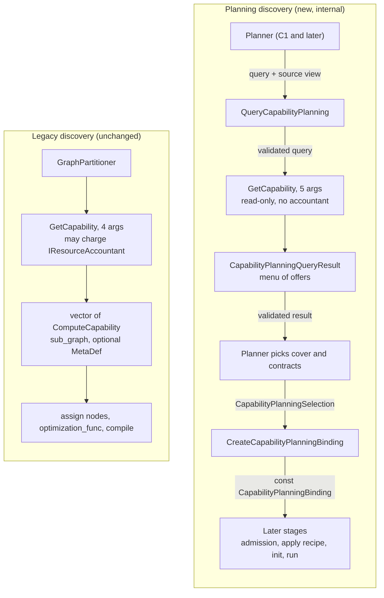
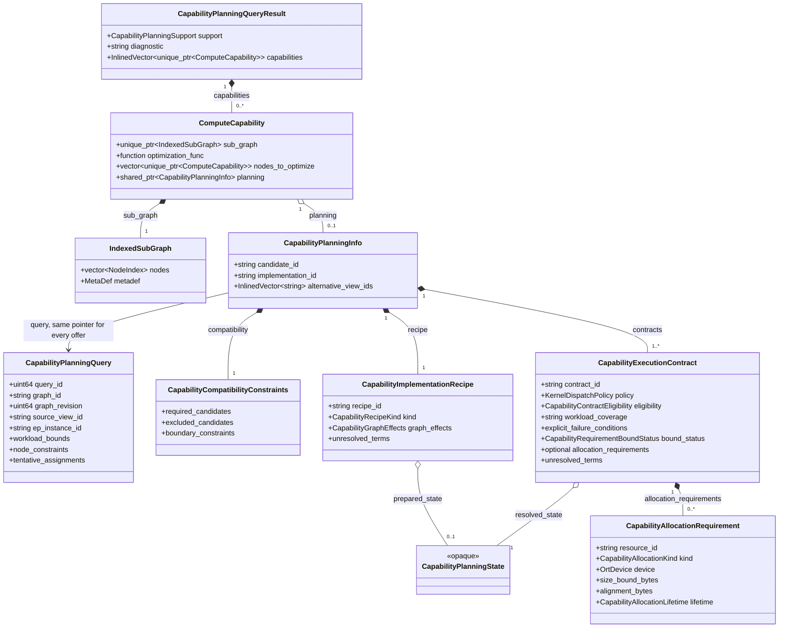
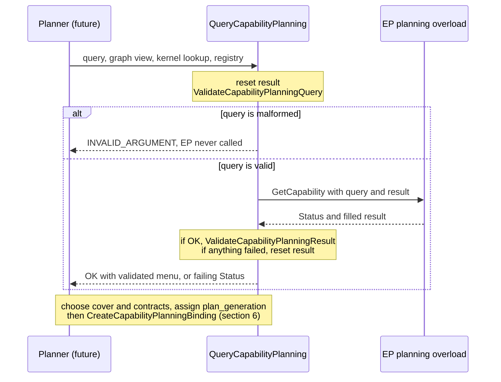
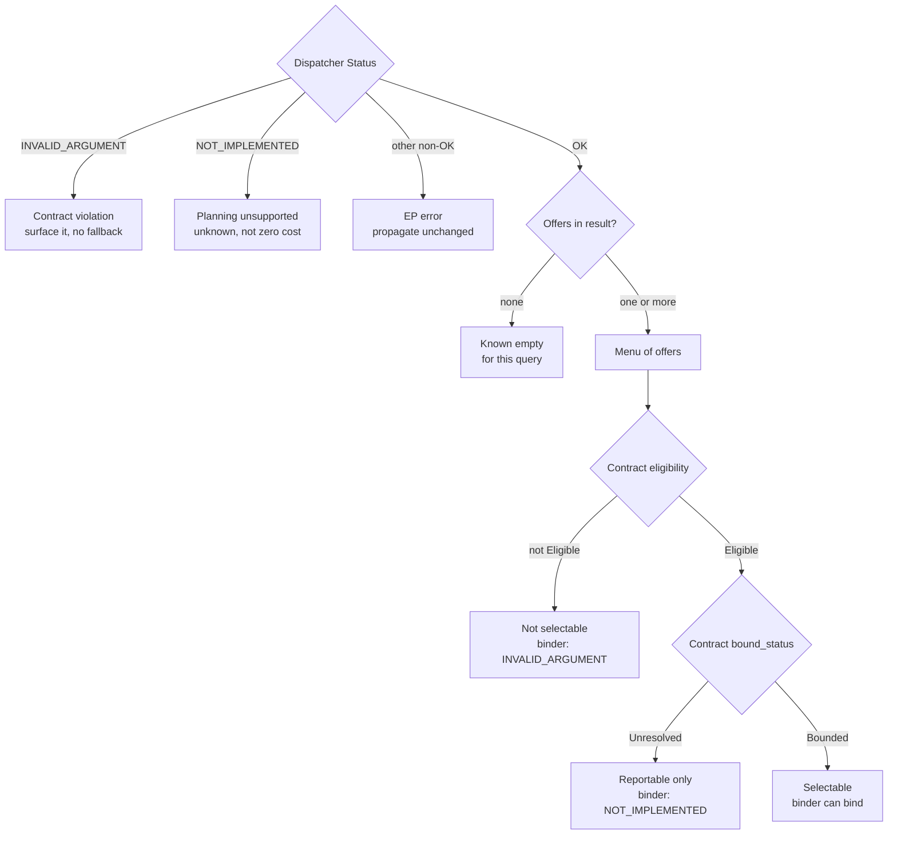
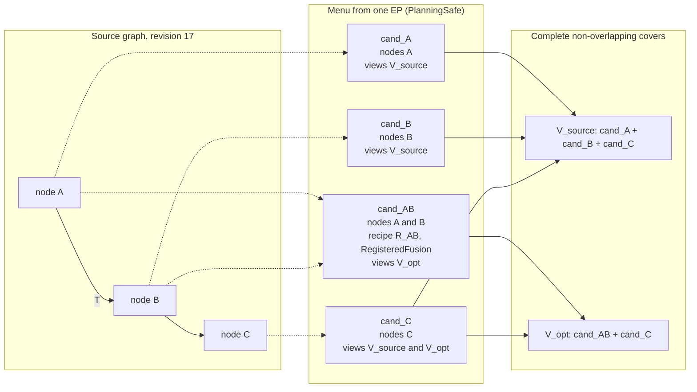
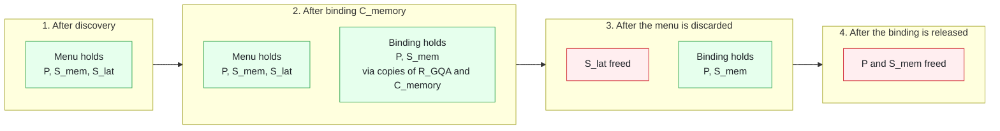
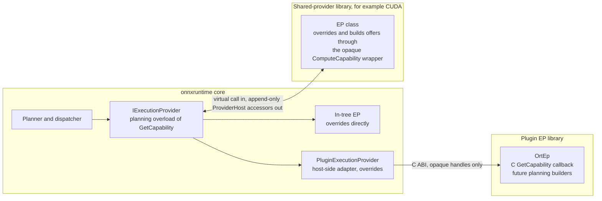

# Capability Planning Interfaces: `GetCapability` and `ComputeCapability`

This draft defines the signatures and contracts that [S0](capability_planning_s0.md) leaves open: how an execution
provider (EP) answers a *planning* query, and how each answer is carried in a `ComputeCapability`. It supports the
discovery step of the [region-aware placement proposal](https://github.com/microsoft/onnxruntime/pull/33372)
([pinned design section](https://github.com/microsoft/onnxruntime/blob/c3f809596077921ad5f8500564f3476c4bc0927c/docs/annotated_partitioning/PartitioningWithAnnotationsAndMemoryConstraints.md#proposed-automatic-region-aware-cpugpu-placement)).

It does not define the planner, covers, budget admission, recipe application, or any kernel policy
(see [Out of scope](#14-out-of-scope)). Start with sections 1, 3 and 5. Sections 11 and 13 list the decisions that
need reviewer input.

| Item | Status |
|:-----|:-------|
| Planning types, `ComputeCapability::planning`, `ValidateCapabilityPlanningResult`, `CreateCapabilityPlanningBinding`, `ValidateCapabilityPlanningBindingIdentity` | In S0 (#33841) |
| Planning overload of `IExecutionProvider::GetCapability` and its default | **Proposed here**, lands with C1 |
| Dispatcher `QueryCapabilityPlanning` and exported `ValidateCapabilityPlanningQuery` | **Proposed here**, lands with C1 |
| Shared-provider bridge entries | **Proposed here**, append-only, lands with C1 |
| Plugin-EP C ABI | Mapping requirements only (S0.4). No names or layouts are proposed |

## 1. Summary

```cpp
// include/onnxruntime/core/framework/execution_provider.h

// Unchanged. Existing EPs and the partitioner keep using it.
virtual std::vector<std::unique_ptr<ComputeCapability>>
GetCapability(const onnxruntime::GraphViewer& graph_viewer,
              const IKernelLookup& kernel_lookup,
              const GraphOptimizerRegistry& graph_optimizer_registry,
              IResourceAccountant* resource_accountant = nullptr) const;

// New. Overriding it is an EP's opt-in to planning-safe discovery.
virtual common::Status
GetCapability(const onnxruntime::GraphViewer& graph_viewer,
              const IKernelLookup& kernel_lookup,
              const GraphOptimizerRegistry& graph_optimizer_registry,
              const std::shared_ptr<const CapabilityPlanningQuery>& query,
              CapabilityPlanningQueryResult& result) const;
```

`ComputeCapability` keeps its shape. Planning only uses the optional member that S0 added:

```cpp
struct ComputeCapability {
  std::unique_ptr<IndexedSubGraph> sub_graph;                         // which nodes (unchanged)
  std::function<Status(...)> optimization_func;                       // legacy hook, not used by planning
  std::vector<std::unique_ptr<ComputeCapability>> nodes_to_optimize;  // legacy, not used by planning
  std::shared_ptr<const CapabilityPlanningInfo> planning;             // S0: views, recipe, contracts
};
```

Design in five points:

1. **One discovery name, two overloads.** The legacy overload takes 3-4 arguments and the planning overload takes 5, so
   a call never matches both. Nothing in the existing partitioner calls the planning overload, so default behavior is
   unchanged.
2. **Opt-in by override.** The base default reports `Unsupported`. There is no separate `SupportsPlanning()` virtual
   that could disagree with the override.
3. **`Status` plus an out-parameter.** A vector return cannot tell "the EP cannot answer" from "the EP answered:
   nothing eligible". The planning overload can (table below).
4. **One shared query snapshot.** Every offer holds the same `shared_ptr` to the query. The S0 validator compares
   pointers, so a stale or foreign offer is rejected.
5. **No side effects.** Discovery does not mutate the graph, run `optimization_func`, compile, create kernels, allocate
   device weights, or charge an `IResourceAccountant`. Requirements come back as data.

| EP outcome | Legacy overload | Planning overload |
|:-----------|:----------------|:------------------|
| Real failure | Exception, or silently empty | Non-OK `Status`, preserved |
| Cannot answer in planning-safe mode | Empty (indistinguishable from the next row) | `Unsupported` (the default) |
| Answered, nothing eligible | Empty | OK, `PlanningSafe`, no offers |
| Answered | Non-empty | OK, `PlanningSafe`, one or more offers |

## 2. Terms

| Term | Meaning |
|:-----|:--------|
| Query | `CapabilityPlanningQuery`: an immutable snapshot of graph identity, workload bounds, node constraints, tentative placement, and EP configuration. |
| Offer | One `ComputeCapability` with `planning` set: one way this EP could cover a set of source nodes. Identified by `planning->candidate_id`. |
| Menu | The `CapabilityPlanningQueryResult` for one EP: all offers plus `support` and `diagnostic`. Nothing is selected yet. |
| View | A named version of the graph that an offer applies to, for example `V_source` (as imported) or `V_opt` (with an EP fusion applied). Listed in `alternative_view_ids`. |
| Recipe | How an offer is realized: `Standalone`, `RegisteredFusion`, or `CompiledRegion`, plus its declared graph effects. |
| Contract | A policy-specific (`KernelDispatchPolicy`) promise: eligibility, workload coverage, allocation requirements, and EP-private resolved state. An offer may carry several. |
| Selection | `CapabilityPlanningSelection`: the planner's choice of candidate, recipe, view, contract, and plan generation. |
| Binding | `CapabilityPlanningBinding`: the const, validated result of a selection. It keeps only the chosen recipe and contract. |

## 3. End-to-End Flow

Planning discovery is a second path next to the legacy one, not a replacement.



| | Legacy | Planning |
|:--|:-------|:---------|
| Caller | `GraphPartitioner` | `QueryCapabilityPlanning`, called by the future planner |
| Graph shown | The partitioner's current view | The source view named by `query->source_view_id`, before any selected-placement filter. Placement context arrives in `query->tentative_assignments` and `query->node_constraints` |
| Resource accounting | Optional `IResourceAccountant*`, charged during discovery | None. Requirements are returned in each contract |
| Result | Vector of `ComputeCapability` with `sub_graph` and optional `MetaDef` | `Status` plus a menu of `ComputeCapability` offers with `planning` set |

## 4. `ComputeCapability`



`planning` is `std::shared_ptr<const CapabilityPlanningInfo>` in code. `allocation_requirements` is an
`std::optional`: unset means the list is unknown, not that there are no allocations.

How each member is read in planning mode:

| Member | Legacy meaning | Planning meaning |
|:-------|:---------------|:-----------------|
| `sub_graph->nodes` | Nodes the EP claims | Source nodes this offer covers. Must be non-empty and duplicate-free |
| `sub_graph->GetMetaDef()` | Fused-node definition the partitioner turns into a node | Not validated by S0 and never applied during planning. See [open question 4](#13-open-questions) |
| `optimization_func` | EP-specific optimization the partitioner runs after assignment | Never invoked. A recipe describes the optimization declaratively instead |
| `nodes_to_optimize` | Nested capabilities for `optimization_func` | Not used |
| `planning` | Absent | Declarative metadata. Absence does not establish zero planning requirements |

**Enforced by `ValidateCapabilityPlanningResult` (S0).** Per offer: non-null; `sub_graph` present with valid `nodes`;
`planning` present and `planning->query` is the same pointer as the query; non-empty `candidate_id` (unique within the
result), `implementation_id`, and `recipe_id`; at least one unique `alternative_view_ids` entry and at least one
contract; an `Unresolved` recipe or graph effects must list `unresolved_terms`; `Unchanged` effects cannot declare
introduced, removed, or aliased values; contract ids are unique; a contract that is not `Eligible` needs
`eligibility_reason`; a `Bounded` contract needs a complete requirement list (unique ids, known kind, lifetime, device,
size, and alignment); an `Unresolved` contract needs `unresolved_terms`.

**Conventions (not enforced today).** An EP should leave `optimization_func` and `nodes_to_optimize` unset on planning
offers and should not set `MetaDef` until F1 defines how a fused node is described. See
[open question 4](#13-open-questions).

## 5. `GetCapability`

### 5.1 Parameters

| Parameter | Role |
|:----------|:-----|
| `graph_viewer` | Read-only view of the source graph, before any selected-placement filter. Call-scoped: do not keep it or any `Node` or `NodeArg` pointer after returning |
| `kernel_lookup` | Same as legacy: is a kernel registered for this node on this EP |
| `graph_optimizer_registry` | Same object as legacy. Read-only in planning: the EP must not run registered optimizers on the graph |
| `query` | Immutable snapshot of workload, constraints, and placement context. It is a `shared_ptr` so every offer can hold the same snapshot |
| `result` | Host-owned and filled in place by the EP. Its special members are defined out of line in core, so EP code never constructs, moves, or destroys it |

There is no `IResourceAccountant*`. Passing a null accountant to the legacy overload would not discover requirements
(the CUDA EP skips its resource queries when no accountant is supplied), and passing a real one would charge resources
during discovery. Planning reports requirements as data instead.

New inputs belong in `CapabilityPlanningQuery`, new outputs in `CapabilityPlanningQueryResult`. Neither changes the
virtual's signature.

### 5.2 Contract

| Party | Rule |
|:------|:-----|
| EP | **Read-only.** Do not mutate the `Graph`, run `optimization_func` or a registered optimizer, compile, create kernels, allocate bulk device memory such as weights, or charge an accountant |
| EP | **Call-scoped graph access.** Do not retain `GraphViewer`, `Node`, or `NodeArg` pointers. State that must outlive the call goes in an EP-owned `CapabilityPlanningState` |
| EP | **Repeatable.** The same graph and query give the same menu. The host may re-query when placement changes |
| EP | **Same query.** Set every offer's `planning->query` to the `query` argument itself, not a copy |
| EP | **Set `support`.** `PlanningSafe` when the EP took part, even with no offers. `Unsupported` otherwise, with `capabilities` empty |
| EP | **Errors.** Return non-OK only for real failures. Nothing to offer is OK, `PlanningSafe`, and no offers |
| EP | **Describe, do not guess.** Put unknown terms in `unresolved_terms` instead of inventing numbers |
| Host | Pass a validated query. The dispatcher guarantees it (5.4) |
| Host | Pass the viewer of `query->source_view_id`. Convey placement through `tentative_assignments` and `node_constraints`, not by filtering the viewer |
| Host | Call one EP instance serially, as the partitioner does today |
| Host | Treat `result` as unusable unless the dispatcher returned OK |

### 5.3 Default Behavior

```cpp
// execution_provider.cc
Status IExecutionProvider::GetCapability(const GraphViewer&, const IKernelLookup&, const GraphOptimizerRegistry&,
                                         const std::shared_ptr<const CapabilityPlanningQuery>&,
                                         CapabilityPlanningQueryResult& result) const {
  result.support = CapabilityPlanningSupport::Unsupported;
  result.diagnostic = "Execution provider has not implemented planning-safe capability discovery.";
  return Status::OK();
}
```

- The default does not wrap legacy output. A legacy `GetCapability` may charge an accountant, change EP state, or
  silently omit requirements, so its output is not planning-safe.
- A "proven legacy adapter" can be an opt-in helper that an EP calls from its own planning override. It is not an
  implicit default.
- Returning OK with `Unsupported` lets one place, the result validator, own the `NOT_IMPLEMENTED` mapping.

### 5.4 Dispatcher

The host never calls the virtual directly. It calls a dispatcher that validates on both sides of the EP call.

```cpp
// New header that includes execution_provider.h. Name and location are illustrative:
// IKernelLookup is nested in IExecutionProvider, so capability_planning.h cannot host it.
Status QueryCapabilityPlanning(const IExecutionProvider& ep,
                               const GraphViewer& graph_viewer,
                               const IExecutionProvider::IKernelLookup& kernel_lookup,
                               const GraphOptimizerRegistry& graph_optimizer_registry,
                               const std::shared_ptr<const CapabilityPlanningQuery>& query,
                               CapabilityPlanningQueryResult& result) {
  result = CapabilityPlanningQueryResult{};
  auto status = ValidateCapabilityPlanningQuery(query);  // EP code never sees a malformed query
  if (!status.IsOK()) {
    return status;
  }
  status = ep.GetCapability(graph_viewer, kernel_lookup, graph_optimizer_registry, query, result);
  if (status.IsOK()) {
    status = ValidateCapabilityPlanningResult(query, result);
  }
  if (!status.IsOK()) {
    result = CapabilityPlanningQueryResult{};
  }
  return status;
}

// capability_planning.h: proposed export of S0's anonymous-namespace ValidateQuery.
Status ValidateCapabilityPlanningQuery(const std::shared_ptr<const CapabilityPlanningQuery>& query);
```



Why the dispatcher validates the query before the EP: S0 validates the query only as part of result validation, which
runs after the EP returns. A throwaway EP that read `query->source_view_id` crashed with an access violation when given
a null query. Exporting the existing `ValidateQuery` as `ValidateCapabilityPlanningQuery` closes this. EP code is then
guaranteed a non-null, well-formed query.

The dispatcher resets `result` on any failure and does not drop individual offers. One invalid offer fails the whole
EP result: a partial menu would hide an EP bug and could hand the planner an incomplete cover.

### 5.5 Outcomes



| Dispatcher result | Cause | Planner meaning |
|:------------------|:------|:----------------|
| OK, `PlanningSafe`, no offers | EP took part and found nothing eligible | Known empty for this query |
| OK, `PlanningSafe`, offers | Validated menu | Choose a cover and contracts |
| `NOT_IMPLEMENTED` | `Unsupported` (including OK from the default) or an offer without `planning` | Unknown, not zero cost. Whether this blocks planning is planner policy |
| `INVALID_ARGUMENT` | Malformed query, or an invalid EP result: foreign query pointer, duplicate or empty ids, null capability, offers with `Unsupported`, malformed bounded claims | Bug. Never convert to empty discovery |
| Any other non-OK | The EP's own failure | Propagated unchanged |

## 6. Selection and Binding

The planner picks one offer, one view, and one contract and asks for a binding.

```cpp
Status CreateCapabilityPlanningBinding(const std::shared_ptr<const CapabilityPlanningQuery>& query,
                                       const ComputeCapability& capability,
                                       const CapabilityPlanningSelection& selection,
                                       std::shared_ptr<const CapabilityPlanningBinding>& binding);
```

Checks run in this order. The first failure wins and leaves `binding` unchanged.

| Step | Check | Failure |
|:-----|:------|:--------|
| 1 | Query is valid | `INVALID_ARGUMENT` |
| 2 | The whole offer is valid, including contracts that were not selected | `NOT_IMPLEMENTED` if `planning` is missing, otherwise `INVALID_ARGUMENT` |
| 3 | `plan_generation` is nonzero, and the candidate, recipe, and view match the offer | `INVALID_ARGUMENT` |
| 4 | Recipe kind, recipe terms, graph effects, and effect terms are all resolved | `NOT_IMPLEMENTED` |
| 5 | A `CompiledRegion` recipe or `Described` graph effects has `prepared_state` | `INVALID_ARGUMENT` |
| 6 | The selected `contract_id` exists | `INVALID_ARGUMENT` |
| 7 | The contract is `Eligible` | `INVALID_ARGUMENT` |
| 8 | The contract is `Bounded` | `NOT_IMPLEMENTED` |
| 9 | The contract has `resolved_state` and `workload_coverage` | `INVALID_ARGUMENT` |
| 10 | For covered nodes with a query constraint: the required EP instance matches, and the contract policy is permitted | `INVALID_ARGUMENT` |
| 11 | Build the binding and assign the output | none |

Step 2 validates the offer as a unit. A malformed sibling contract therefore blocks binding of a healthy one. An
`Unresolved` contract fails only its own binding at step 8 and does not affect its siblings.

A binding is a local check. It does not prove whole-plan feasibility and is not budget admission.
`ValidateCapabilityPlanningBindingIdentity(query, plan_generation, binding)` later guards that a binding still
belongs to the active query and plan generation.

## 7. Views and Covers

One EP can offer several ways to cover the same nodes. `alternative_view_ids` says which views an offer belongs to.
The planner picks a view and a complete, non-overlapping cover of it. For `A -> T -> B -> C`, where the EP can fuse
`A` and `B`:



| Cover | View | Offers | Valid |
|:------|:-----|:-------|:------|
| 1 | `V_source` | cand_A, cand_B, cand_C | Yes |
| 2 | `V_opt` | cand_AB, cand_C | Yes, if `A` and `B` are placed together on this EP |
| 3 | `V_opt` | cand_AB, cand_B, cand_C | No: `B` is covered twice |
| 4 | `V_source` | cand_A, cand_C | Only if another EP offers `B` |

- These are alternative sets of capabilities, not necessarily two `ComputeCapability` objects per view. An offer like
  `cand_C` appears once and lists both views.
- Cross-offer rules are declared in `planning->compatibility` (`required_candidates`, `excluded_candidates`,
  `boundary_constraints`). The planner enforces them.
- If a placement boundary falls between `A` and `B`, `cand_AB` is not usable. The planner publishes a new query with
  the new tentative assignments and re-queries.
- An indivisible fused or compiled offer is accepted whole or rejected. Nodes that are already fused in the input stay
  atomic.
- `cand_AB` eliminates the internal value `T`. If a consumer outside `A` and `B` also read `T`, the recipe must preserve
  it or be rejected.

## 8. Ownership and Lifetime

The example offer has recipe `R_GQA`, which points to `prepared_state` `P`, and two contracts: `C_memory`, which points
to `resolved_state` `S_mem`, and `C_latency`, which points to `S_lat`. Each pointer is a
`shared_ptr<const CapabilityPlanningState>`. The planner binds `C_memory`. The diagram shows who keeps each state alive.



| Object | Held by | Released when |
|:-------|:--------|:--------------|
| `CapabilityPlanningQuery` | The planner, every offer, every binding | The last holder drops it |
| Offer and its `CapabilityPlanningInfo` | The menu | The menu is discarded |
| Unselected contract state (`S_lat`) | The menu only | The menu is discarded |
| Selected recipe and contract state (`P`, `S_mem`) | The menu and the binding | The last of the two is dropped |
| `CapabilityPlanningBinding` | Later stages (C3, I2) | The session or kernel owners release it. S0 does not install owners yet |

A binding copies only the selected recipe and contract and does not keep the menu. Discarding the menu therefore frees
unused contract state while the selected state stays valid.

`CapabilityPlanningState` subclasses are defined and destroyed in the EP's library. Sessions must release offers and
bindings before that library unloads.

## 9. Crossing EP Boundaries



| EP kind | Reached by | Offers are built by | C1 work |
|:--------|:-----------|:--------------------|:--------|
| In-tree | Direct virtual override | `std::make_unique<ComputeCapability>`, then assign `planning` | The override |
| Shared-provider library (CUDA, ...) | Virtual call through the library's `IExecutionProvider` vtable | `ComputeCapability` is an opaque wrapper created through `ProviderHost`. Attach `planning` through a new append-only accessor such as `ComputeCapability__SetPlanning` | Define the planning default in `provider_bridge_provider.cc` (the library's vtable references it). Add the accessor to `provider_interfaces.h`, `provider_wrappedtypes.h`, and `provider_bridge_ort.cc` |
| Plugin EP | `PluginExecutionProvider` overrides the planning overload | The adapter maps C builders into internal `ComputeCapability` and `planning`, and attaches the host's query snapshot | Return `Unsupported` until a planning-safe C extension exists |

`ProviderHost` is append-only. Shared-provider code needs the complete `CapabilityPlanningQueryResult` to fill it, so
the recommended approach is to let provider builds include the S0 plain-data header. See
[open question 3](#13-open-questions).

The published C callback stays as it is:

```cpp
ORT_API2_STATUS(GetCapability, _In_ OrtEp* this_ptr, _In_ const OrtGraph* graph,
                _Inout_ OrtEpGraphSupportInfo* graph_support_info);
```

S0.4 lists the mapping requirements for a future versioned extension: an explicit planning-safe feature check, versioned
`OrtEpApi` accessors for a borrowed query view, new builders on `OrtEpGraphSupportInfo`, an opaque state handle with a
release callback (ownership transfers on success only), and no STL types, virtual classes, `shared_ptr`, or borrowed
graph pointers across the ABI. New table members are append-only, per `.github/instructions/c-api.instructions.md`.
This document proposes no C names or layouts.

## 10. Worked Example: GQA

An EP opts in by overriding both overloads. The values mirror the S0 test fixture. Node 42 is that fixture's GQA node.
Real discovery of GQA nodes and bounds belongs to C3.

```cpp
class ExampleEp : public IExecutionProvider {
 public:
  ExampleEp() : IExecutionProvider{"ExampleEp"} {}

  std::vector<std::unique_ptr<ComputeCapability>> GetCapability(
      const GraphViewer&, const IKernelLookup&, const GraphOptimizerRegistry&,
      IResourceAccountant*) const override {
    return {};  // legacy discovery, unchanged
  }

  Status GetCapability(const GraphViewer&, const IKernelLookup&, const GraphOptimizerRegistry&,
                       const std::shared_ptr<const CapabilityPlanningQuery>& query,
                       CapabilityPlanningQueryResult& result) const override {
    auto sub_graph = std::make_unique<IndexedSubGraph>();
    sub_graph->nodes = {42};
    auto capability = std::make_unique<ComputeCapability>(std::move(sub_graph));

    auto planning = std::make_shared<CapabilityPlanningInfo>();
    planning->query = query;
    planning->candidate_id = "GQA_42";
    planning->implementation_id = "GQA_cuda_fp16";
    planning->alternative_view_ids = {query->source_view_id};
    planning->recipe.recipe_id = "R_GQA";
    planning->recipe.kind = CapabilityRecipeKind::Standalone;
    planning->recipe.graph_effects.kind = CapabilityGraphEffectsKind::Unchanged;

    CapabilityAllocationRequirement workspace;
    workspace.resource_id = "workspace";
    workspace.kind = CapabilityAllocationKind::ExecutionWorkspace;
    workspace.device = query->execution_device;
    workspace.size_bound_bytes = 213248;
    workspace.alignment_bytes = 0;
    workspace.lifetime = CapabilityAllocationLifetime::Operation;

    CapabilityExecutionContract memory;
    memory.contract_id = "C_memory";
    memory.policy = KernelDispatchPolicy::Memory;
    memory.eligibility = CapabilityContractEligibility::Eligible;
    memory.workload_coverage = "declared prefill, chunked-prefill and decode envelope";
    memory.resolved_state = std::make_shared<const ExampleGqaState>();  // EP-private routes
    memory.bound_status = CapabilityRequirementBoundStatus::Bounded;
    memory.allocation_requirements = InlinedVector<CapabilityAllocationRequirement, 1>{workspace};
    planning->contracts.push_back(std::move(memory));
    // C_latency: same shape, policy Latency, 1,245,440 byte workspace, routes Flash, MEA, unfused.

    capability->planning = std::move(planning);
    result.capabilities.push_back(std::move(capability));
    result.support = CapabilityPlanningSupport::PlanningSafe;
    return Status::OK();
  }
};
```

The planner side, using S0 fixture values (query id 1, graph `decoder` revision 17, plan generation 7):

```cpp
CapabilityPlanningQueryResult menu;
ORT_RETURN_IF_ERROR(QueryCapabilityPlanning(ep, graph_viewer, kernel_lookup, registry, query, menu));

CapabilityPlanningSelection selection;
selection.candidate_id = "GQA_42";
selection.recipe_id = "R_GQA";
selection.alternative_view_id = "V_source";
selection.contract_id = "C_memory";
selection.plan_generation = 7;

std::shared_ptr<const CapabilityPlanningBinding> binding;
ORT_RETURN_IF_ERROR(CreateCapabilityPlanningBinding(query, *menu.capabilities.front(), selection, binding));
menu = CapabilityPlanningQueryResult{};  // frees C_latency state. The binding keeps R_GQA and C_memory state alive
```

| Query field | Value |
|:------------|:------|
| Identity | query 1, graph `decoder`, revision 17, view `V_source`, EP `CUDA:0` on NVIDIA GPU 0 |
| Workload bounds | batch 1..1, query_length 1..4, total_kv 0..64, kv_capacity 64..64 |
| Node constraint | Node 42 permits `Memory` and `Latency` |
| Concurrency | `max_concurrent_runs` 1, `max_compute_streams` 1 |

| Contract | Policy | Execution workspace | Other three allocation kinds | Retained routes |
|:---------|:-------|:--------------------|:-----------------------------|:----------------|
| `C_memory` | `Memory` | 213,248 B, `Operation` lifetime | Known zero for this configuration | Flash prefill and the covering unfused fallback |
| `C_latency` | `Latency` | 1,245,440 B | Known zero for this configuration | Flash, MEA, unfused |

## 11. Alternatives Considered

| Option | Shape | Verdict |
|:-------|:------|:--------|
| A. Same-name overload | `Status GetCapability(..., query, result)` | **Recommended.** Opt-in by override, legacy untouched, arities never collide. Caveat: a concrete class that overrides only one overload hides the other unless it adds `using IExecutionProvider::GetCapability;`. The framework calls through `IExecutionProvider&`, so this is benign |
| B. Distinct name | For example `Status GetExecutionCandidates(...)` | **Fallback.** No overload or hiding questions, at the cost of one more name. Only the identifier changes; sections 5.1 to 5.5 stay valid |
| C. Add parameters to the legacy virtual | | Rejected. Breaks about 22 EP overrides, and a vector return cannot carry `Status` or `support` |
| D. Mixin interface and `dynamic_cast` | | Rejected. Needs RTTI across provider libraries |
| E. New `ExecutionCandidate` type | | Rejected. The proposal reuses `ComputeCapability` and its consumers |
| F. Non-virtual wrapper over a protected virtual | | Possible later. The dispatcher already centralizes validation, so it is deferred |
| G. Separate `SupportsPlanning()` virtual | | Rejected. A second source of truth that can disagree with the override |

## 12. Verification Evidence

The following was checked with throwaway programs that are not in the repository. C1 should carry the behavioral
checks as unit tests.

| Claim | Check | Result |
|:------|:------|:-------|
| The planning overload compiles against the real S0 headers under ORT-style flags | Scratch translation unit with a patched copy of `execution_provider.h` (two forward declarations plus the new virtual). MSVC 14.44, `/std:c++20 /W4 /WX`. `static_assert`s on the shape of `ComputeCapability` and `CapabilityPlanningQueryResult` | Clean |
| Both overloads are callable through `IExecutionProvider&` without ambiguity | Calls with 3, 4, and 5 arguments in the same unit | Clean |
| A concrete class overriding only the legacy overload cannot call the planning overload | Negative probe | C2660 as expected. `using IExecutionProvider::GetCapability;` fixes it |
| Overriding one overload does not warn | MSVC: only `/w14266`, which ORT does not enable. Clang and GCC: read from compiler source and documentation, **not executed here** | No warning expected |
| The dispatcher, validator, and binder behave as described in sections 5 and 6 | A harness linked against the real `capability_planning.cc` and `status.cc`: 47 checks | All passed |

Findings that shaped the design:

- A null or malformed query reached EP code, and a throwaway EP crashed on it, until the dispatcher validated the query
  first. The call-count check now shows zero EP calls for a malformed query and exactly one for a valid one.
- A malformed unselected sibling contract blocks binding of a healthy contract.
- An `Unresolved` bound contract returns `NOT_IMPLEMENTED` while its sibling still binds.
- Unselected contract state expires when the menu is discarded. Selected state expires when the binding is reset.

## 13. Open Questions

1. **Overload or distinct name.** Same-name overload (recommended) or `GetExecutionCandidates`. See section 11.
2. **Where the query is validated.** Export `ValidateCapabilityPlanningQuery` and validate in the dispatcher
   (recommended), or guarantee validity in the query builder only. The second leaves EP code exposed to any builder bug.
3. **Provider-library access to S0 types.** Recommended: shared-provider builds include `capability_planning.h` (plain
   data, with `CapabilityPlanningQueryResult`'s special members out of line in core), attach `planning` through one
   `ComputeCapability__SetPlanning` accessor, and define the planning default locally. The alternative is an opaque
   accessor for every field, which is a large append-only `ProviderHost` surface.
4. **Offer hygiene.** Should the result validator also reject planning offers that set `optimization_func` or
   `nodes_to_optimize`, or whose `MetaDef` disagrees with `recipe.graph_effects`? The first two are cheap to enforce
   and keep a planning offer from entering the legacy optimizer path. `MetaDef` agreement can wait for F1.
5. **Dispatcher name and home.** `QueryCapabilityPlanning` and the header that hosts it are illustrative.

## 14. Out of Scope

- The planner, cover search, selection policy, and whole-plan or budget admission.
- Recipe application and initialization (F1, F2, I2), and the L1-to-allocation adapter (C2).
- GQA contract and binding wiring in CUDA (C3).
- A concrete C API for plugin EPs.
- Any change to the legacy partitioner path or the legacy `GetCapability` overload.
