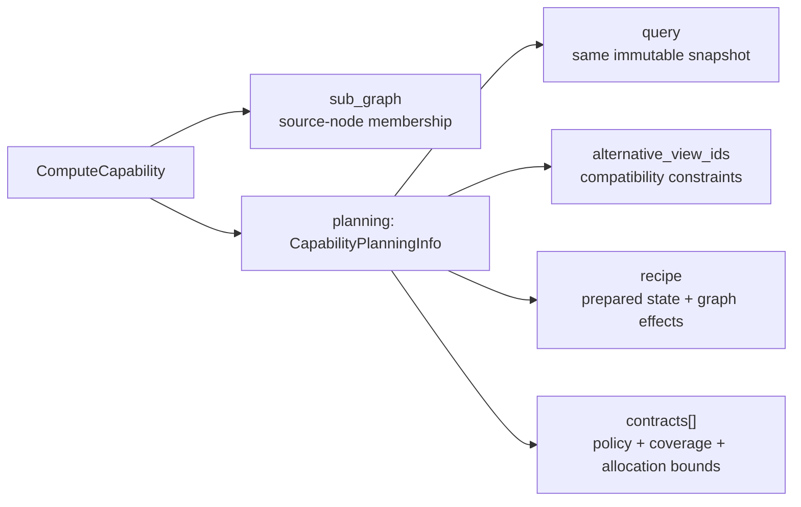
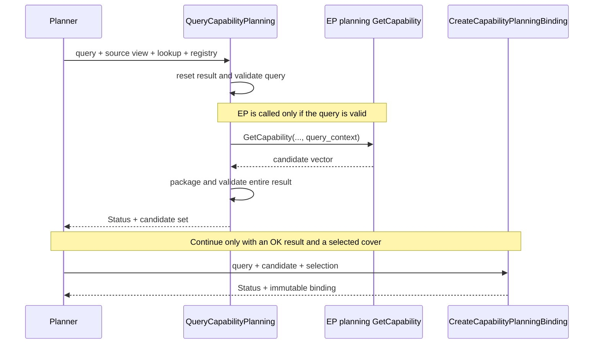
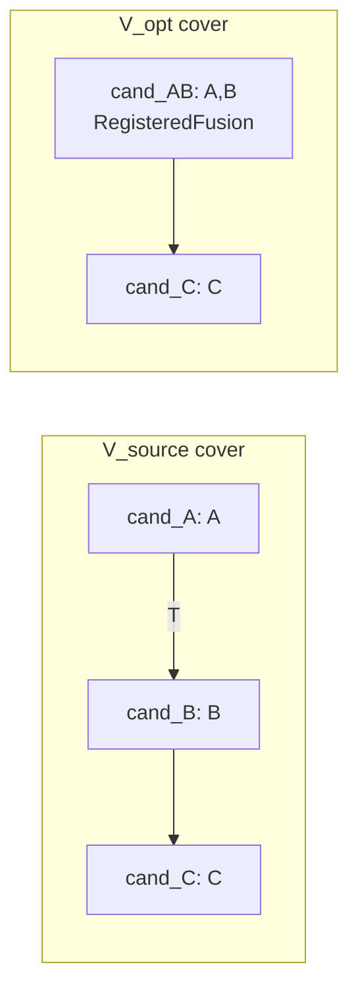

# Capability Planning Interfaces

This draft defines planning-safe execution-provider (EP) discovery for the
[region-aware CPU/GPU placement proposal](https://github.com/microsoft/onnxruntime/pull/33372).
Its allocation vocabulary also supports the
[policy-based workspace estimation proposal](https://github.com/microsoft/onnxruntime/pull/32944).
An **execution candidate** is a `ComputeCapability` with a `CapabilityPlanningInfo` payload: one implementation
of a source-node set, with alternative execution contracts. It is not a placement decision or a memory reservation.

**Decision:** keep the legacy `GetCapability` signature unchanged; add a planning `GetCapability` overload with the
same return type and planning context as its fourth argument. Carry planning output in `ComputeCapability::planning`.

**Implemented (S0, #33841):** internal query/candidate/selection/binding types, result validation, and local binding
helpers. These are not wired into discovery or execution; existing discovery, hooks, accountants, and C APIs remain
unchanged.

**Proposed (C1 and later):** the planning overload, host dispatcher, normalization, shared-provider bridge, and
C transport.
The planner, whole-plan admission, recipe application, and runtime integration are outside this interface draft.

## Discovery API

```cpp
// IExecutionProvider, in include/onnxruntime/core/framework/execution_provider.h.
// Forward-declare outside the SHARED_PROVIDER include guard.
struct CapabilityPlanningQuery;

// Existing: unchanged.
virtual std::vector<std::unique_ptr<ComputeCapability>>
GetCapability(const onnxruntime::GraphViewer& graph_viewer,
              const IKernelLookup& kernel_lookup,
              const GraphOptimizerRegistry& graph_optimizer_registry,
              IResourceAccountant* resource_accountant = nullptr) const;

// Proposed planning overload: declare after the last existing virtual (see ABI discussion).
virtual std::vector<std::unique_ptr<ComputeCapability>>
GetCapability(const onnxruntime::GraphViewer& graph_viewer,
              const IKernelLookup& kernel_lookup,
              const GraphOptimizerRegistry& graph_optimizer_registry,
              const std::shared_ptr<const CapabilityPlanningQuery>& query_context) const;
```

Only the legacy overload defaults its fourth argument. Through `IExecutionProvider&`, three arguments or a fourth
`nullptr`/`IResourceAccountant*` select legacy; a query `shared_ptr` selects planning. Overriding one overload hides
the other on a concrete EP type: use `using IExecutionProvider::GetCapability;` or override both to expose both.
Without that using-declaration, a planning-only concrete EP call with `nullptr` can select planning with a null query.
The dispatcher calls through the base reference.

The first three parameters retain their roles. The host supplies the query's **source graph view**, before any
selected-placement filter. `query_context` is a validated, immutable snapshot of the facts below.

Planning has no accountant: requirements are returned as data, not charged during discovery. Passing a null
accountant to legacy discovery is not equivalent; for example, CUDA skips its resource queries in that case.

An EP opts in by overriding the planning overload. The base default returns `{}` without calling legacy discovery.
Define it out of line in `execution_provider.cc`, and separately in `provider_bridge_provider.cc` for shared
providers; `ComputeCapability` is incomplete in `execution_provider.h`. The CPU EP also needs an explicit planning
override or adapter; its legacy kernel-lookup default does not establish planning support.

Discovery must be repeatable and read-only: no graph mutation, `optimization_func` invocation, compilation, kernel
creation, bulk device allocation, or resource commitment. Read-only optimizer selection functions are allowed.
The host calls each EP instance serially. Graph and node views are call-scoped and must not be retained.

## Query snapshot

| Query facts | Members |
|:------------|:--------|
| Identity | `mode = Planning`, `query_id`, `graph_id`, `graph_revision`, `source_view_id`, `ep_instance_id` |
| Workload | `max_input_shapes`, `workload_bounds` |
| Placement constraints | `node_constraints`, `tentative_assignments` |
| Execution assumptions | `execution_device`, `ep_configuration`, `max_concurrent_runs`, `max_compute_streams` |

Publish an owned const snapshot; candidates and bindings retain that exact object, not copies with matching IDs.
`query_id` is a nonzero diagnostic/transport ID. `graph_id` distinguishes graph scopes, including nested graphs;
`graph_revision` is scoped to that graph and may be zero. Node indices and graph-value names belong to this scope
and revision; `ep_instance_id` identifies a provider instance, not just its type.

`workload_bounds` describes named nonnegative ranges, including logical lengths and allocated cache capacity.
A missing upper bound is unknown; known zero is valid. `max_input_shapes` reuses shape overrides, but downstream
shape inference can be non-monotonic: these overrides alone are not analytical upper-bound proofs.
Concurrency bounds are optional positive assumptions, not proof that an EP supports those execution modes.
The planned initial integration targets bounded workloads, serialized Runs, and validated single-stream execution.

`node_constraints` is normalized input, with one entry per constrained source node. Required EP assignments are
hard pins. Unset `permitted_policies` preserves the configured policy; a present list permits exactly those intents,
and an empty list permits none. `Auto` does not authorize widening EP-private runtime routes.

`tentative_assignments` is trial ownership, not committed placement. `ep_configuration` copies canonical effective
facts, including relevant defaults/build features; it is neither a borrowed session-options pointer nor a channel
for mutating per-query EP options. Missing facts needed by an estimator become unresolved terms.

Changes to graph, workload, constraints, placement, device, configuration, or execution assumptions require a new
snapshot. There is no cache-retagging mechanism; reusing descriptors would require a separate proof of validity.

## `CapabilityPlanningInfo`

**Definition:** `CapabilityPlanningInfo` is the immutable, query-specific description of **one candidate**. It
identifies an implementation, declares compatible graph views and companion constraints, describes how to realize
the implementation, and offers policy-specific execution contracts. Source-node membership stays in `sub_graph`.

`sub_graph->nodes` identifies source work, not necessarily nodes remaining after lowering. Boundary information,
including external value/initializer dependencies, comes from its `MetaDef` or the source graph. A planning region
can contain several candidates; each candidate is indivisible.

The attachment in `ComputeCapability` is optional; existing members and constructors remain unchanged. Member-only
view:

```cpp
struct ComputeCapability {
  std::unique_ptr<IndexedSubGraph> sub_graph;
  std::function<Status(Graph&, const ComputeCapability&, ComputeCapability&, const GraphOptimizerRegistry&)>
      optimization_func;
  std::vector<std::unique_ptr<ComputeCapability>> nodes_to_optimize;
  std::shared_ptr<const CapabilityPlanningInfo> planning;
};
```

The complete payload definition, from
[`capability_planning.h`](../../onnxruntime/core/framework/capability_planning.h):

```cpp
struct CapabilityPlanningInfo {
  std::shared_ptr<const CapabilityPlanningQuery> query;
  std::string candidate_id;
  std::string implementation_id;
  InlinedVector<std::string> alternative_view_ids;
  CapabilityCompatibilityConstraints compatibility;
  CapabilityImplementationRecipe recipe;
  InlinedVector<CapabilityExecutionContract, 1> contracts;
};
```

| Field | Meaning and responsibility |
|:------|:---------------------------|
| `query` | The original discovery snapshot, not a copy. It supplies `query->graph_revision`, EP identity, workload, and configuration. It is the validity token; matching IDs alone neither prove safe reuse nor form a complete cache key. |
| `candidate_id` | Identifies this particular offer from an EP instance. Non-empty and unique within this EP's result; cross-candidate references also name the EP instance. |
| `implementation_id` | Non-empty identity of the implementation this candidate describes. |
| `alternative_view_ids` | Identifies alternative sets of capabilities produced together, such as standalone and optimized views. A shared candidate can belong to several views; its view IDs must be unique and non-empty. |
| `compatibility` | `required_candidates`, `excluded_candidates`, and `boundary_constraints` express required companions, exclusions, and layout/device agreements. Disjoint source membership alone does not establish compatibility; the planner enforces these relationships. |
| `recipe` | Identifies the reproducible implementation: standalone kernel, registered fused kernel, compiled-region lowering, or explicitly unresolved. A standalone recipe may require no rewrite. Different recipes are different candidates. |
| `contracts` | One or more contracts with distinct IDs. These are alternative policies for this implementation, not simultaneous memory charges. |



### Recipe and execution contracts

A **recipe** says how to realize the candidate. A **contract** says under which policy and workload that
implementation is eligible, what it may allocate, and which EP-owned state must survive selection.
State pointers retain opaque, EP-owned `CapabilityPlanningState` host metadata, not compiled executables,
materialized kernels, or borrowed graph views.
Only the EP interprets this state. Framework code must not inspect route masks or invoke hidden graph-application
methods through this holder.

```cpp
using CapabilityPlanningStatePtr = std::shared_ptr<const CapabilityPlanningState>;

struct CapabilityImplementationRecipe {
  std::string recipe_id;
  CapabilityRecipeKind kind = CapabilityRecipeKind::Unresolved;
  CapabilityPlanningStatePtr prepared_state;
  CapabilityGraphEffects graph_effects;
  InlinedVector<std::string> unresolved_terms;
};

struct CapabilityExecutionContract {
  std::string contract_id;
  KernelDispatchPolicy policy = KernelDispatchPolicy::Auto;
  CapabilityContractEligibility eligibility = CapabilityContractEligibility::Unresolved;
  std::string eligibility_reason;
  std::string workload_coverage;
  InlinedVector<std::string> explicit_failure_conditions;
  CapabilityPlanningStatePtr resolved_state;

  CapabilityRequirementBoundStatus bound_status = CapabilityRequirementBoundStatus::Unresolved;
  std::optional<InlinedVector<CapabilityAllocationRequirement, 1>> allocation_requirements;
  InlinedVector<std::string> unresolved_terms;
};
```

| Nested field | Meaning and responsibility |
|:-------------|:---------------------------|
| `recipe.prepared_state` | Retains the prepared match, replacement/lowering choice, and dependencies needed to apply that implementation without independently selecting a different one. This can be CPU-side metadata. |
| `recipe.graph_effects` | Describes resulting tensors, boundaries, shapes/types, aliases, and storage effects compactly, without a full graph copy per candidate. The protocol uses this descriptor, not a separate `planning_graph` type. Its kind is `Unresolved`, `Unchanged`, or `Described`; `Unchanged` cannot declare rewrites or alias changes. |
| `contracts[].contract_id`, `contracts[].policy`, `contracts[].resolved_state` | Identifies an enforceable execution policy, including permitted runtime choices. The ID references retained, query-bound EP state, not just an intent string that may later resolve differently. |
| `contracts[].eligibility`, `contracts[].eligibility_reason` | Distinguishes static support conditions from allocation-bound status, with a reason when support is unresolved or ineligible. |
| `contracts[].workload_coverage`, `contracts[].explicit_failure_conditions` | Describes admitted runtime states and conditions that must fail instead of escaping to an unaccounted implementation. A bounded contract need not guarantee successful execution for every request. |
| `contracts[].allocation_requirements` | Describes implementation-owned persistent/prepack storage, initialization scratch, runtime preparation, workspace, and other storage by resource identity, device, size bound, alignment, and lifetime. Declared alias/non-overlap relationships require later validation; whole-plan logic resolves physical backing. |
| `contracts[].bound_status`, `contracts[].unresolved_terms` | Records whether requirements are sufficiently bounded for this query and which terms remain unknown or unsupported. A candidate may be executable yet lack enough information for strict-budget admission. |

Introduced tensor shapes/types may be unresolved for reporting; whole-plan admission must resolve or conservatively
bound them. The compact effects descriptor is not a general graph-transformation language.

### Allocation requirements

**Unknown is not zero.** An unset `allocation_requirements` means unknown. A present empty list with `Bounded`
asserts no relevant implementation-owned allocations. A bounded list must identify every allocation's kind,
device, size, alignment, and lifetime, with resolved relationship identities and alias offsets where supplied.
Zero alignment requests the allocator default; it does not establish zero allocator overhead.

These are **additional implementation-owned allocations**, not a whole-session footprint. ORT separately accounts
for graph tensors, transfers, external KV storage, and allocator overhead. `Operation` lifetime ends after device
work completes, not after its host launch returns.

Resource IDs are logical, not allocator addresses. Implementation allocations are scoped by EP instance and
candidate; graph-value references are scoped by the query graph. Alias offsets must be explicit. `alias_of` and
`non_overlap_with` do not authorize deduplication by name or an unverified maximum: backing/reuse planning must
validate location, extent, lifetime, and device-completion compatibility. Categories alone imply no sharing.
An introduced graph initializer and device prepack remain separate resources unless validated sharing establishes
otherwise; `Other` must not double-charge framework-owned storage.

The future allocation adapter maps existing L1 estimates as follows, using implementation sizing helpers rather
than treating legacy default zeros as proven zeros:

| Existing L1 category | Planning allocation category |
|:---------------------|:-----------------------------|
| `runtime_workspace_bytes` | `ExecutionWorkspace` |
| `persistent_prepack_bytes` | `PersistentPrepack` |
| `initialization_scratch_bytes` | `InitializationScratch` |
| `runtime_transient_bytes` | `RuntimePreparation` |

### Candidate validation

`ValidateCapabilityPlanningResult` checks non-empty, duplicate-free source membership, the original query pointer,
identities, views, and every contract. Unresolved recipes, effects, and requirements need diagnostics; non-eligible
contracts need an eligibility reason. Reportable unresolved contracts are valid discovery output, but not bindable.
Publish queries, payloads, and EP state as const without mutable aliases.

### GQA schema example

The [host-only GQA fixture](../../onnxruntime/test/framework/capability_planning_test.cc) has candidate `GQA_42`,
implementation `GQA_cuda_fp16`, recipe `R_GQA`, and view `V_source`:

| Contract | Policy | Execution workspace | Retained routes |
|:---------|:-------|:--------------------|:----------------|
| `C_memory` | `Memory` | 213,248 bytes | Flash prefill plus covering unfused fallback |
| `C_latency` | `Latency` | 1,245,440 bytes | Flash, MEA, unfused |

The proposal's example configuration is FP16 on SM80/108 SMs, 8 query heads/2 KV heads, head size 512, batch 1,
query length 1..4, total KV at most 64, and cache capacity 64, with one concurrent Run and one compute stream.
Workspace lifetime is `Operation`; the three other L1 categories are known zero for this fixture, not by default.
These are alternative bounds, not simultaneous charges or general GQA constants. The fixture does not execute CUDA
or prove estimator coverage. Initial GQA integration will expose one configured contract before alternative-policy
discovery is added.

## Query and binding protocol

The planner calls a host dispatcher rather than the virtual directly. Proposed declarations:

```cpp
Status ValidateCapabilityPlanningQuery(const std::shared_ptr<const CapabilityPlanningQuery>& query);

Status QueryCapabilityPlanning(const IExecutionProvider& ep,
                               const GraphViewer& graph_viewer,
                               const IExecutionProvider::IKernelLookup& kernel_lookup,
                               const GraphOptimizerRegistry& graph_optimizer_registry,
                               const std::shared_ptr<const CapabilityPlanningQuery>& query_context,
                               CapabilityPlanningQueryResult& result);
```

Expose the existing internal query validator and call it **before entering EP code**. The dispatcher header must include
`execution_provider.h` because `IKernelLookup` is nested in `IExecutionProvider`.



| Dispatcher result | Meaning |
|:------------------|:--------|
| OK, `PlanningSafe` | Validated, non-empty candidate set. Contracts may still be unresolved. |
| `NOT_IMPLEMENTED` | Empty return or missing `planning`: no planning-safe answer, **not known-zero cost**. |
| `INVALID_ARGUMENT` | Malformed query or candidate, including null entries, foreign query pointers, duplicate IDs, or incomplete bounded claims. |
| `FAIL` | The EP threw a `std::exception`; preserve its message. |

Keep all returned entries for validation; never silently drop invalid candidates. Any failure clears the result,
and diagnostics survive in the returned `Status`. One invalid candidate rejects the whole EP result.
Diagnostics belong to the caller; expected planning rejections are not Run-error telemetry and do not initialize
the runtime environment.

The vector return cannot distinguish unsupported discovery from an opted-in EP finding no eligible candidates.
Both map to `Unsupported`. The implemented result type and validator support `PlanningSafe` with an empty set,
but this call shape cannot produce that distinction. Exceptions are its only EP failure channel; without exception
support, throwing aborts.

### Selecting and retaining a contract

```cpp
Status CreateCapabilityPlanningBinding(const std::shared_ptr<const CapabilityPlanningQuery>& query,
                                       const ComputeCapability& capability,
                                       const CapabilityPlanningSelection& selection,
                                       std::shared_ptr<const CapabilityPlanningBinding>& binding);
```

The selection names `candidate_id`, `recipe_id`, `alternative_view_id`, `contract_id`, and a nonzero
`plan_generation`. The binder validates the entire candidate, then requires a resolved recipe/effects and an
`Eligible`, `Bounded` contract with retained state and workload coverage. Compiled recipes or described graph
effects also require `prepared_state`. Covered nodes must satisfy the query's EP pins and permitted policies.

Malformed or ineligible selections return `INVALID_ARGUMENT`; unresolved recipes or selected bounds return
`NOT_IMPLEMENTED`. Failure leaves the existing binding unchanged. A malformed sibling contract blocks binding;
a valid unresolved sibling does not.

A binding copies source membership, compatibility, the recipe, and **only the selected contract**, sharing the
original query and selected states. Discarding the candidate set can release unselected states without losing the
selected ones. `ValidateCapabilityPlanningBindingIdentity` checks the active query and plan generation.
This is a local validity check, **not whole-plan feasibility or budget admission**.

The source revision remains the planning origin after a verified rewrite. Later stages must track replacement
provenance, not overwrite the query revision. Changed interfaces, larger bounds, changed lifetimes, or uncovered
runtime states require verified re-planning before incompatible allocation/use, or explicit failure.

| Later stage | Required integration; not supplied by the binding helper |
|:------------|:--------------------------------------------------------|
| Recipe application | Apply the selected prepared recipe with source provenance; reconcile actual effects before commitment. |
| Initialization | Propagate the same binding into registered-kernel creation or compiled-region construction; do not independently re-resolve its contract. |
| Requirement verification (L2) | Check actual implementation requirements against selected bounds and backing assumptions before allocation/use. |
| Run/dispatch | Enforce retained permissions, coverage, failure conditions, and the active plan generation. |

Rejected trials and initialization failures release their owned descriptors/bindings. Committed session/kernel
owners must retain selected state until last use, including outstanding device work; this ownership is not wired
yet. Retained state and hooks must not capture borrowed graph/node pointers. Release candidates and bindings before
their EP library unloads.

## Views and existing optimization hooks

Candidates may overlap during discovery; a selected cover must not. For source work `A -> B -> C`, an EP can offer
standalone candidates and a fused `A,B` alternative:



`cand_C` appears once in the result and lists both views. Selecting `cand_AB` together with `cand_B` is invalid
because `B` is covered twice. A fused/compiled candidate is atomic: accept it whole or reject it. A placement
boundary between `A` and `B` requires another cover or re-query. Eliminating `T` is valid only if external consumers
are preserved or remapped. Compatibility and whole-cover checks belong to the planner, not the local binder.

`nodes_to_optimize`, `optimization_func`, and optional `MetaDef` coexist with `planning`; their legacy meaning is
unchanged. Planning and binding never run application hooks. Later recipe application must apply the selected
implementation and reconcile its actual effects against `planning->recipe`. Current validators do not check
hook/recipe or `MetaDef` consistency. Existing TensorRT and CUDA runtime-fusion producers (#33705, #33757) need
explicit integration.

## EP boundaries and ABI

The chosen interface is **Alternative A: a planning `GetCapability` overload**. Declare it after
`GetEpContextDataCallbackRequirements`, the last existing virtual, to preserve existing slot order on Itanium.
This does not preserve existing slot order on MSVC.

| Boundary | Required integration |
|:---------|:---------------------|
| In-tree EP | Override the planning `GetCapability` overload and attach `planning` directly. |
| Shared-provider C++ library | Use the opaque `ComputeCapability` wrapper; append `ComputeCapability__SetPlanning` to `ProviderHost`. Define the empty default locally, so it needs no host forwarding entry. |
| Plugin EP C ABI | Preserve the published `OrtEp::GetCapability`. Future version-gated C builders and explicit planning-safe opt-in map into internal metadata; no STL, C++ virtual objects, or `shared_ptr` representations cross this boundary. See [C transport](#future-plugin-ep-c-transport). |

**MSVC caveat:** MSVC groups same-name virtual overloads at their first declaration, newest overload first.
The added overload shifts the legacy `GetCapability` and later slots even when declared last. Itanium uses
declaration order. This MSVC analysis comes from Clang's ABI implementation, not an MSVC layout test.

This choice relies on **rebuilding core and shared providers together**, not mixed-version compatibility.
`IExecutionProvider` does not have a strictly append-only history (`SupportsMoeOffload`, #33575), and
`ProviderLibrary::Load` has no version handshake. `ProviderHost` entries and published C API tables retain their
append-only constraints.

Letting provider builds include `capability_planning.h` extends existing C++ layout assumptions to its STL,
`InlinedVector`, `optional`, and shared-state members. Header compatibility under `SHARED_PROVIDER` remains unchecked.

| Alternative | Tradeoff |
|:------------|:---------|
| A. Same-name `GetCapability` overload | **Chosen.** Keeps the proposal's name, return shape, and existing overrides; requires overload/name-hiding care and matching rebuilt libraries. |
| B. One `GetCapability` keyed on `mode` | Removes overload mechanics, but changes every override and retypes the shipped `IExecutionProvider__GetCapability` bridge entry. |
| D. `Status GetCapability(..., query_context, result)` | Explicit errors and support/empty-result semantics, but changes the return shape and exposes `CapabilityPlanningQueryResult` to EP code. |
| E. Distinct-name planning virtual | Avoids overload/name-hiding mechanics and preserves existing slots on both ABIs, but introduces a second discovery name. |

### Future plugin EP C transport

This is a mapping contract, not implemented API names or layouts. The published callback remains unchanged:

```cpp
ORT_API2_STATUS(GetCapability, _In_ OrtEp* this_ptr, _In_ const OrtGraph* graph,
                _Inout_ OrtEpGraphSupportInfo* graph_support_info);
```

1. Check explicit planning-safe feature support before a planning query. API version alone is not opt-in or a
   side-effect guarantee.
2. The host owns the immutable query and exposes a borrowed read-only C view through `OrtEpGraphSupportInfo`, using
   versioned `OrtEpApi` accessors. Reply builders attach the host's original snapshot, not a plugin-created C++ query.
3. New builders describe candidates, contracts, and resources. They transfer opaque EP state ownership only on
   success; on failure the EP retains ownership.
4. A release callback runs exactly once when the last candidate/binding owner drops the state. Its wrapper retains
   the EP/factory dependencies until release.
5. Versioned selected-binding accessors must reach both compiled-region and registered-kernel creation, retaining
   state beyond call-scoped graph views.

New public table members are append-only and version-checked before access. No STL objects, C++ virtual types,
C++ graph/node pointers, or `shared_ptr` representations cross this ABI. The existing plugin adapter is not converted
by the prototype; a legacy provider requires an explicit planning-safe adapter or is reported as unsupported.
Preserve callback/builder errors; never turn them into successful empty discovery.

## Remaining decisions

- **Empty results and failure channel:** keep the conservative vector convention, add an opt-in marker for
  known-empty discovery, or adopt Alternative D.
- **Shared providers:** confirm payload-header/layout compatibility and whether to enforce matching library versions
  before using the changed `IExecutionProvider` vtable.
- **Integration:** choose the CPU planning adapter, minimal-build guard, and header locations.
- **Application:** decide how later stages reconcile stored hooks with prepared recipes.

The proposed discovery/dispatcher interfaces have not been compiled against ORT headers, the bridge has not been
checked, and the diagrams have not been rendered.
