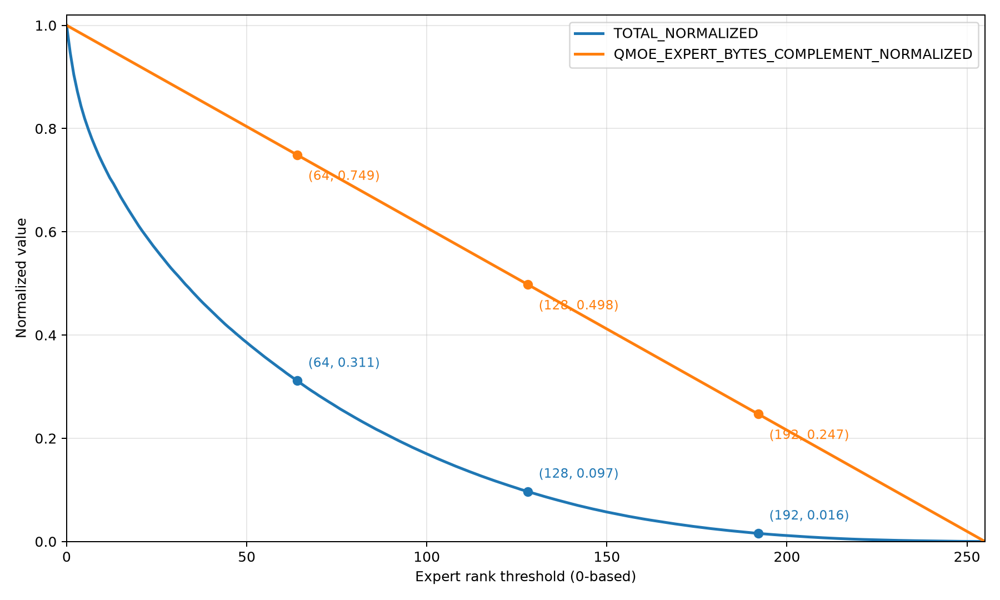
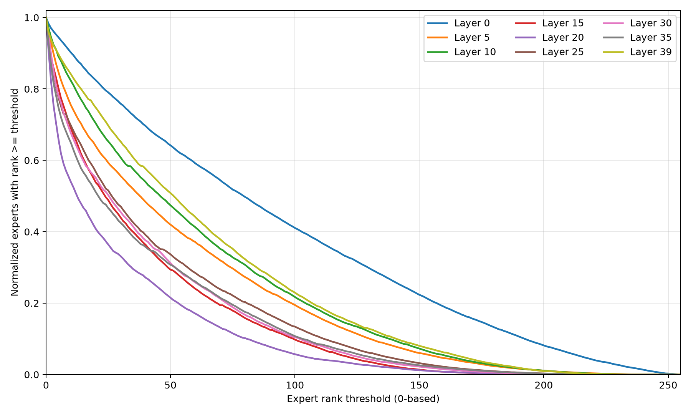

# Adaptive CUDA expert offloading for Qwen 3.6 MoE

**Status:** Implementation in progress

**Date:** 2026-09

## Objective

Implement adaptive expert placement for Qwen 3.6 and other Mixture-of-Experts (MoE) models whose expert weights do not
all fit in GPU memory.

CPU and CUDA each hold a disjoint, configurable subset of experts. Each `MoE` and `QMoE` node maintains one
exponentially decayed counter per expert, uses those counters to rank experts, and exchanges experts between CPU and
CUDA asynchronously.

The placement policy has two levels, both evaluated by the pilot after a complete model inference:

- Exchange hot CPU experts with cold CUDA experts when their counter differences exceed a configurable threshold.
- Redistribute the global CUDA expert budget across nodes while maximizing the number of nodes that can run entirely
  on CUDA.

Training, router changes, expert-weight quantization, and multiple CUDA devices are outside this implementation.

## Implemented foundations

- [#32261](https://github.com/microsoft/onnxruntime/pull/32261) added opt-in MoE/QMoE routing instrumentation,
  reproducible prompt and analysis tools, and the first routing measurements.
- [#32738](https://github.com/microsoft/onnxruntime/pull/32738) added the session-global expert state, CPU and CUDA
  expert-selection collection, and exponentially decayed counters. It does not implement placement, CPU offload,
  swaps, or redistribution.
- [#33039](https://github.com/microsoft/onnxruntime/pull/33039) added static FP16/BF16 CUDA `MoE` placement, hybrid
  CPU/CUDA execution, and compact CUDA expert storage.
- The adaptive-swap implementation exchanges hot CPU experts with cold CUDA experts asynchronously while preserving
  each node's CUDA slot count. Global slot redistribution across nodes remains future work.
- Expert swaps transpose matrix weights between CUDA and MLAS layouts on their dedicated CUDA streams, rather than
  blocking the transfer pipeline with a CPU transposition callback. Incoming and outgoing experts use separate pinned
  buffers; publication waits for both transfers to finish before changing the CPU/CUDA maps.

## Exploratory routing analysis

An exploratory trace was collected from Qwen3.5-35B-A3B INT4 on CUDA using 10 prompts. It contains 59,880 valid routing
records from 40 QMoE layers, with 256 experts per layer and top-k 8. The frequency ranks below are zero-based and
learned from the complete trace. These preliminary results demonstrate the routing concentration but are not an
end-to-end offload performance measurement.

The first graph compares the fraction of routing decisions selecting an expert at or above a frequency-rank threshold
with the fraction of expert-weight bytes that can be offloaded at that threshold. Keeping only the 64 most frequent
experts of each layer on CUDA retains about 25.1% of expert bytes and covers about 68.9% of observed selections. Keeping
the first 128 experts retains about 50.2% of expert bytes and covers about 90.3% of selections. Keeping the first 192
retains about 75.3% of expert bytes and covers about 98.4% of selections. The curve therefore shows substantial routing
concentration, but it also shows that an aggressive memory reduction sends a meaningful fraction of expert work to CPU.

[](images/normalized-total-vs-expert-bytes.png)

The second graph compares the same rank-threshold distribution for representative early, middle, and late QMoE layers.
The shapes differ substantially: for example, layer 20 concentrates its selections among fewer experts, while layer 0
uses a broader portion of its expert set. A single fixed per-layer CUDA capacity is therefore unlikely to use the global
budget efficiently. This motivates per-node counters and the second implementation step's redistribution across nodes.

[](images/selected-layers-expert-ranks.png)

## Global offload configuration

The numerical policy parameters are exposed as session configuration entries:

| Session option | Parameter | Meaning and valid range |
|---|---|---|
| `session.moe_cpu_offload_experts` | Offload count | Global number of experts to execute from CPU (`>= 0`); default `0`. |
| `session.moe_expert_counter_alpha` | `alpha` | Counter decay coefficient in `[0, 1]`; selected experts receive `1 - alpha`; default `0.75`. |
| `session.moe_expert_counter_probability_weight` | Probability weight | Blend in `[0, 1]` between binary selection and routing probability; default `0`. |
| `session.moe_expert_swap_epsilon` | `epsilon` | Relative swap margin, finite and `>= 0`; default `0.01`. |
| `session.moe_max_in_flight_swaps_per_device` | Swap concurrency | Maximum concurrent adaptive swaps per CUDA device (`>= 0`); `0` disables adaptive swaps; default `4`. |

The optional `session.moe_expert_counter_state_file` path is configured separately.

The CPU offload count has the following meaning:

- A non-negative integer is the total number of experts to offload to CPU.
- Negative values, non-integer values, and counts larger than the total number of eligible CUDA FP16/BF16 `MoE` experts
  are invalid.
- Zero disables expert offloading.

The global CUDA budget is:

```text
cuda_expert_count = total_expert_count - cpu_offload_expert_count
```

One CUDA slot contains all weights required to execute one expert. CPU and CUDA storage contain disjoint expert
subsets: CPU-resident experts use compact MLAS-layout storage, while CUDA-resident experts use compact CUDA storage.
There is no permanent CPU copy of every CUDA expert. An exchange preserves both stores' capacities and moves the
outgoing CUDA weights into the incoming expert's CPU slot only when publication is safe.

## Expert counters

Each `MoE` and `QMoE` node owns one counter for each of its experts. After the node executes, every counter is updated
once:

```text
count_{t+1}(e) = alpha * count_t(e) + (1 - alpha) * (1 if expert e was used, otherwise 0)
```

The used term is binary for one invocation. Selecting the same expert for several rows still contributes `1`, not the
number of routed rows.

For CPU-offloaded CUDA MoE nodes, `session.moe_expert_counter_probability_weight=lambda` changes the selected-expert
contribution to `(1 - lambda) + lambda * probability`. Repeated selections within one invocation use the maximum
routing probability observed for that expert. `0` preserves binary counting and `1` uses only routing probability.

CPU-offloaded CUDA nodes update their counters on the GPU. The pilot consumes counter snapshots and selected-expert
metadata at the end of the run, before scheduling swaps, rather than waiting for routing on the host at every node.
Only successful kernel invocations are committed, and asynchronous CPU execution errors are propagated by `EndRun`.
Repeated invocations of the same node consume the preceding snapshot before reusing its buffers.

On devices supporting CUDA stream memory operations, routing compacts only rows that select a CPU-resident expert.
A short notification callback wakes a per-node CPU worker only for a nonempty compacted batch. That worker transfers
the compacted activations and routing, executes MLAS, and uploads only those rows' contributions. CUDA expert kernels
can run concurrently; the compute stream waits for the CPU result only before scattering and combining it.
At that boundary, the host must ensure the worker has enqueued its upload before inserting the CUDA upload event and
stream-memory wait. A wait on a future, CUDA-invisible upload alone can deadlock during subgraph execution or tactic
profiling. The upload dependency makes the producer visible to CUDA without moving the wait ahead of CUDA expert GEMMs.
Single-row decode with no CPU routes releases that device-side wait directly on GPU, without waiting for the host
notification. Devices without stream memory operations retain the synchronous CPU execution path.

The policy exposes `alpha` in `[0, 1]` and non-negative `epsilon`. Counters are updated in place and remain bounded by
the larger of their initial value and `1`. Their defaults and constraints are covered by option-parsing tests.

Expert identity is `(graph_scope, node_index, node_type, expert_id)`. Ranking is by descending counter. Ties are resolved
by `expert_id`, then graph scope and node index, so placement is deterministic.

When counter logging is enabled, each event reports only the experts selected by that invocation. Each selected-expert
record contains the local `expert_id`, its pre-update `score`, its zero-based `selected_rank` among the selected
experts, its zero-based `node_rank` among every expert in the node, its zero-based `global_position` among every
expert in the model, and its current `device` (`CPU` or `CUDA`). Ranks use descending score. Local ties are broken by
expert ID, while global ties are broken by the fixed model-wide expert index. The device reflects the currently
published placement; an asynchronous swap is not visible until the kernel publishes it. Each event also reports
`moe_count` and `total_expert_count`.

At the end of each successful run, `moe_expert_swaps` reports the number of in-flight swaps and eligible candidates
blocked by the concurrency limit, both per CUDA device and in total. Candidates are recalculated after every run and
are not retained in a persistent queue. `scheduled_swaps` identifies every exchange started by that run, including
the node, the outgoing CUDA expert, the incoming CPU expert, and their counter scores.

```json
"selected_experts": [
  {
    "expert_id": 7,
    "score": 0.1,
    "selected_rank": 0,
    "node_rank": 3,
    "global_position": 1024,
    "device": "CUDA"
  }
]
```

```json
"scheduled_swaps": [
  {
    "graph_scope": "main",
    "node_index": 12,
    "device_id": 0,
    "outgoing_cuda_expert": 41,
    "incoming_cpu_expert": 173,
    "outgoing_score": 0.05,
    "incoming_score": 0.2
  }
]
```

## Initial counter state

An optional session setting names a UTF-8 text file containing initial counter values:

```text
session.moe_expert_counter_state_file=<path>
```

The file starts with a format-version line and contains one line per
`(graph_scope, node_index, node_type, expert_id, counter_value)` record. Loading validates:

- the format version;
- graph scope, node identity, and operator type;
- expert index bounds;
- uniqueness of every expert record;
- finite, non-negative counter values.

Experts omitted from the file start at zero. When the setting is absent, all counters start at zero.

The first offload implementation uses loaded counters to select the highest-ranked experts globally. If all counters
are zero, it distributes CUDA slots round-robin across eligible nodes and selects lower local expert IDs first. This
placement remains fixed when adaptive swaps are disabled. With swaps enabled, each node retains its initial CUDA
slot count, but the experts assigned to those slots can change after successful inference boundaries.

## Per-node placement update

One invocation uses an immutable expert-to-device mapping:

- CUDA-resident experts execute on CUDA.
- CPU-resident experts execute on CPU.
- Counter updates do not change the mapping used by the current invocation.

After execution and counter updates, a node with experts on both CPU and CUDA computes:

```text
cpu_max = maximum counter among CPU experts
cuda_min = minimum counter among CUDA experts
```

The node exchanges the corresponding experts only when:

```text
cpu_max > (1 + epsilon) * cuda_min
```

Counter ties use expert ID order. The pilot evaluates placement only after the complete model inference and selects at
most one exchange per node for that boundary. Exchanges are fully asynchronous with respect to the next inference.

Each exchange uses separate incoming and outgoing pinned host buffers, one shared CUDA layout buffer, and an extra
CUDA staging slot so the published mapping remains usable until the complete exchange is ready:

1. Record completion of all CUDA work that references the expert selected for CPU residency.
2. Transpose the outgoing matrix weights to MLAS layout on CUDA and copy them to the outgoing pinned buffer.
3. Stage the selected CPU expert in incoming pinned memory. After the outgoing transfer finishes, upload the incoming
   data and transpose it on CUDA into the extra CUDA slot.
4. Record a transfer-completion event.
5. Commit the outgoing expert to its CPU allocation and publish the new mapping only after both directions have completed.

The CPU-bound transfer completes before the CPU-to-CUDA transfer starts because both directions reuse the CUDA layout
buffer; this is an implementation constraint, not a restriction imposed by NVIDIA copy engines. An exchange never
overwrites the currently published CUDA slot. If the next inference reaches the same `MoE` before the exchange completes,
the kernel uses the pre-exchange mapping and does not wait. A later invocation observes the new placement only after
the pilot has published the completed exchange.

```text
inference t
    -> every MoE/QMoE executes with immutable placement P
    -> counters are updated
    -> after Run() completes, the pilot selects and enqueues exchanges

inference t+1, node L
    -> if L's exchange is incomplete, execute with placement P without waiting
    -> if L's exchange is complete, publish and execute with placement P+1
```

CUDA devices expose their copy-engine count, but that value does not provide a portable expert-level concurrency
guarantee. The initial implementation therefore permits at most four in-flight expert exchanges per CUDA device.
Separate pinned buffers, CUDA staging slots, and copy streams allow transfers from different exchanges to overlap.
Within one exchange, the incoming transfer waits for the outgoing transfer before reusing the shared CUDA layout
buffer. Publication waits for both directions. Hardware with one copy engine serializes the transfers without changing
correctness. Additional eligible exchanges are reconsidered at a later inference boundary, not retained in a queue.
Each node that has swapped retains two expert-sized pinned buffers and two expert-sized CUDA staging/layout buffers
for reuse. The in-flight exchange limit does not bound these persistent allocations across nodes.

## Planned end-of-inference redistribution

Redistribution across nodes is not implemented. A future policy could recompute how many CUDA experts belong to each
node after complete model inference, while preserving the global CUDA budget. Current adaptive swaps only exchange
experts within a node and never transfer CUDA slots between nodes.

The allocation objective is lexicographic:

1. Maximize the number of nodes whose complete expert set is CUDA-resident.
2. Among allocations with the same number of complete CUDA nodes, maximize the sum of counters retained on CUDA.
3. Break remaining ties by node index and expert ID.

Within each node, keep the experts with the highest counters. Redistribution may transfer slot ownership between
nodes, whereas a per-node exchange changes the expert stored in a slot without changing that node's slot count.

The future redistribution policy must not drain or wait for pending exchanges. A node with an incomplete exchange
must continue using its published pre-exchange placement. Slot metadata must change only after both transfer directions
complete.

## Operator integration

Routing instrumentation covers `com.microsoft::MoE` and `com.microsoft::QMoE`. CPU offload and adaptive swaps currently
cover only built-in CUDA FP16/BF16 `MoE`, without changing its exported schema or inserting a new graph operator.

The graph node remains assigned to the CUDA execution provider. Its CUDA kernel:

- owns or accesses the runtime expert cache;
- dispatches resident experts to CUDA;
- invokes shared CPU expert-compute helpers for CPU-resident experts;
- submits counter updates and, once adaptive swaps are enabled, placement changes to the cache manager.

Session initialization uses the constant-weight prepacking path to materialize the CPU and CUDA subsets in their
respective compact stores. Constant FC1/FC2 weights and any connected biases, enabled prepacking, and a statically known
hidden dimension are required. With CPU offload disabled, the existing dynamic-weight CUDA path is unchanged.

When `session.moe_cpu_offload_experts` is `0` or absent, CPU and CUDA `MoE`/`QMoE` behavior remains unchanged.

## State ownership and concurrency

The root `SessionState` owns a dedicated `KernelPilotMoeExpertState` shared with its subgraph session states. It contains:

- policy parameters;
- per-node expert counters;
- the global expert budget and per-node allocation targets.

CPU and CUDA kernels obtain their session-owned `KernelPilot` through `OpKernelContext::GetKernelPilot()`.
The generic pilot in `core/framework` carries no kernel-specific logic; `KernelPilotMoeExpertSelection`, defined in
`kernel_pilot_moe_expert_selection.h`, deduplicates selected expert IDs. CUDA-specific copies and events stay in a
provider-side adapter.
After successful kernel execution, the executor records usage through
`KernelPilotMoeExpertState::RecordUsage()`. CPU usage is committed directly; CUDA-offloaded usage is deferred until
`EndRun` consumes the provider snapshot and updates the host mirror. Failed kernel invocations are drained without
committing their counters, while earlier successful invocations still commit if later run work fails. Swaps are
scheduled only when the overall run succeeds. These are internal C++ calls, not a public C API.
Expert identity includes graph scope as well as node and expert IDs, so nodes in different
subgraphs cannot collide. The state persists across `Run()` calls and is isolated from other sessions.

Each CUDA kernel cache owns device-specific resources and execution state:

- CUDA slots, one reusable staging slot, one shared layout buffer, and the current immutable mapping;
- separate reusable incoming and outgoing pinned host staging buffers;
- at most one pending exchange;
- CUDA completion events.

Initialization builds an immutable dictionary from `(OpKernel pointer, local expert ID)` to a global expert index.
Counters are ordinary values; their update path does not acquire a mutex when logging is disabled. Counting and adaptive
placement require non-overlapping `Run()` calls on a session, enforced at run entry. Distinct kernels may update disjoint expert ranges,
but a kernel cannot execute twice simultaneously. Global snapshots are read between runs.
Each invocation captures a stable placement mapping, and a slot cannot be overwritten until all work using its
previous contents has completed.

Errors are explicit. Invalid configuration, invalid initial state, allocation failures, copy failures, and event
failures fail session initialization or execution rather than silently disabling offload or retaining stale placement.

## Implementation scope

The combined implementation includes static hybrid inference and adaptive placement in one change. Static placement
remains available by setting `session.moe_max_in_flight_swaps_per_device=0`; enabling swaps does not change the operator
schema or the session-global CPU expert count.

### Step 1: static FP16/BF16 placement and hybrid inference

Implemented for the built-in CUDA FP16 and BF16 `MoE` paths:

- Parse and validate `session.moe_cpu_offload_experts`; `0` disables offloading.
- Use loaded counters to select CUDA experts globally; distribute an all-zero budget round-robin across eligible nodes.
- Keep only CPU-resident experts in compact GEMM-layout CPU storage and materialize CUDA-resident experts in compact
  CUDA storage. A swap exchanges one expert between these fixed-capacity stores through reusable staging buffers.
- Keep this initial placement immutable: this step has no swaps or end-of-inference redistribution.
- Dispatch CUDA-resident routes through CUTLASS. CPU-resident FP16 routes use MLAS FP16 GEMMs; BF16 weights are
  converted once during initialization and CPU-resident BF16 routes use MLAS FP32 GEMMs.
- Complete the host input copy before CUDA expert kernels can overwrite an aliased input/output buffer, then overlap
  CPU and CUDA expert GEMMs.
- Combine CPU and CUDA expert results on CUDA without changing the exported `MoE` model contract.
- Continue collecting complete routing selections and updating counters.
- Preserve dynamic FP16/BF16 weights and the existing CUDA implementation when offloading is disabled.
- Test CPU-only, CUDA-only, and mixed expert execution, numerical agreement, counter updates, invalid configuration,
  and unchanged disabled-path behavior.

Current limitations are deliberate: constant FC1/FC2 weights are required; FC3, sparse mixer, QMoE, FP32,
minimal builds, CUDA graph capture, and the CUDA plugin EP are not supported by this first slice.
Prepacking must remain enabled, the input hidden dimension must be statically known, and connected FC1/FC2 biases
must also be constant.

### Step 2: adaptive expert swaps

Implemented in the adaptive-swap change:

- Use the session-global counters and optional initial counter state to rank experts.
- Apply the strict `cpu_max > (1 + epsilon) * cuda_min` rule and let the pilot schedule exchanges after inference.
- Move the CUDA expert to pinned CPU staging before moving its replacement to the extra CUDA slot.
- Use dedicated device-to-host and host-to-device streams, events, and separate staging allocations for each active
  exchange.
- Permit at most four in-flight exchanges per CUDA device; additional eligible nodes are reconsidered at the next
  inference boundary.
- Pipeline the host-to-device transfer of one exchange with the device-to-host transfer of another when the hardware
  supports bidirectional copies.
- Never wait for an incomplete exchange when a `MoE` starts. The old placement remains published until transfer
  completion; publication copies the staged expert into the persistent slot on that invocation's compute stream.
- Preserve each node's CUDA slot count and therefore the session-global CUDA expert budget.
- Test the strict epsilon boundary, deterministic tie-breaking, multi-exchange concurrency, delayed
  publication, and numerical parity before and after a swap.

Still planned:

- Redistribute CUDA slot ownership across nodes without draining pending exchanges, while maximizing the number of
  completely CUDA-resident nodes.
- Add end-to-end throughput and memory measurements for representative Qwen models.

After these two implementation steps, the remaining work is end-to-end measurement. Run reproducible CPU-only,
CUDA-only, and hybrid evaluations with identical models, prompts, and generation settings; sweep offload targets and
policy parameters; and record the metrics listed below. Commit the evaluation scripts, aggregate results, and documented
commands while keeping oversized raw traces outside the repository.

## Performance evaluation

Measure:

- token throughput;
- peak CUDA memory;
- peak CPU memory.

### Reproducible warmed-decode protocol

[`benchmark_moe_cpu_offload.py`](../../tools/python/benchmark_moe_cpu_offload.py) uses the existing GenAI environment
and a source-built ORT runtime. On Linux, `ORT_PYTHON_ROOT` must expose an `onnxruntime` package whose `capi` directory
contains the matching shared runtime and CUDA provider libraries, or symlinks to them. GenAI locates these libraries
through the package found on `PYTHONPATH`; selecting the right Python executable alone does not select the right ORT
binary. Verify the resolved `ORT_LIB_PATH` after importing GenAI and record the runtime/provider hashes.

```bash
CUDA_VISIBLE_DEVICES=5 PYTHONPATH="$ORT_PYTHON_ROOT:tools/python" \
python tools/python/benchmark_moe_cpu_offload.py \
  --name cpu1000-alpha0p9-epsilon0p1 \
  --model "$MODEL_PATH" --prompts "$PROMPTS_PATH" \
  --prompt-limit 5 --max-new-tokens 256 \
  --cpu-offload-experts 1000 --counter-alpha 0.9 --swap-epsilon 0.1 \
  --swap --no-counter-log --no-cuda-graph \
  --output result.json --log result.log
```

Each fresh process runs five prompts, with counters and placement retained between prompts. Generation is greedy and
has a fixed length of 256 tokens. `append_tokens()` is prefill and is timed separately. The first
`generate_next_token()` uses those precomputed logits, so it is excluded from decode timing. Score only prompts 3-5:
each contributes 255 actual decode inferences, or 765 calls per repetition. The reported repetition score is the mean
of those three prompts' `decode.mean_ms` values, not the total generation duration or the best prompt.

Run three independent repetitions per configuration and report their mean, sample standard deviation, and range.
Run configurations serially on one otherwise idle GPU, interleaving configurations between repetitions to reduce
temporal drift. Do not profile, build, or run other GPU tests during measurements. Memory is sampled every 50 ms;
reported peaks include initialization and all five prompts. GPU memory is device-wide NVML usage, while CPU memory
is process RSS.

The parameter sweeps use alpha `{0.5, 0.75, 0.9, 0.95, 0.99}`, epsilon `{0, 0.01, 0.05, 0.1, 0.2, 0.5}`, and CPU
expert counts `{0, 250, 500, 1000, 2000}`. Hold the other parameters at alpha `0.9`, epsilon `0.1`, and 1,000 CPU
experts. These are benchmark reference values, not changed session defaults. The common reference is measured three
times and reused in all three tables: 14 unique configurations and 42 fresh processes. Probability weighting remains
at its default of zero and the swap concurrency limit is four. At zero CPU experts there is no offload, counter
instrumentation, or applicable exchange; that row is the all-GPU reference, not a measurement of active swaps.
